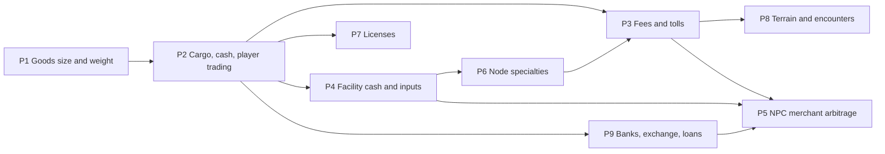

# Economy rules implementation plan

Order follows dependencies: cargo is needed by trading, trading by costs, and all of them by merchants.
Each phase ends with EditMode tests (determinism, save/load, Burst parity where a job is involved).

| Phase | Scope | Systems | Ready? |
|---|---|---|---|
| P1 | `weight`/`size` per base good in goods data and native arrays; capacity helper | SYS-INVENTORY | Ready |
| P2 | `CargoTable` (cart, warehouses), cash per continent coin, buy/sell commands at current price, partial fills, placeholder capacities, random village start, save migrations | SYS-INVENTORY, SYS-PLAYER-START | Ready |
| P3 | Base fee per trip, per-unit charge, toll on every entered node valued at local prices | SYS-TRAVEL-COSTS | Ready (surcharge needs P6) |
| P4 | Facility cash, input purchase from stock, all-or-nothing, income at current price, bankruptcy (player facilities too), player output to warehouse with overflow sale | SYS-PRODUCTION | Ready |
| P5 | Detailed arbitrage merchants with cargo, trips, costs, licenses, bankruptcy, loans; aggregate node-to-node flows with expected encounter loss | SYS-MERCHANTS | After P3, P4, P9 |
| P6 | Terrain tags on nodes, tag-to-specialty table, four specialty effects | SYS-PRODUCTION | Ready (placeholder data) |
| P7 | Per-good licenses issued by nations, yearly renewal, sell check, NPC holders | SYS-LICENSES | Ready |
| P8 | Route terrain (turns, cost), encounter roll per trip, guards and insurance, passage and owned ships | SYS-ROUTE-HAZARDS | Ready |
| P10 | Elasticity classes, demand weights (size, wealth, population), Pareto households, basic price index later | SYS-MARKETS | Ready; basket deferred (Q-030) |
| P9 | State-owned national and international banks, exchange with fee, deposits with interest and payment, loans for all holders on any collateral, weekly repayment, seizure and auction | SYS-BANKING | Ready; money totals wait on Q-025 |

## Notes
- P2 changes the player's cash into per-continent coin balances. Until P9 exists the player simply cannot
  obtain foreign coins, which is consistent with DEC-031.
- P6 feeds P3: the toll surcharge applies to a node's specialty categories. P3 can start with base rates.
- Tolls on every entered node and per-trip cost evaluation make P5 the heaviest phase at full scale
  (9,250 merchant groups): keep detailed merchants to the LOD region and run the aggregate flow pass as a
  Burst job from the start.
- Placeholder numbers (capacities, rates, effect sizes, loss ratios, prices) go to `config.csv` / data
  files marked [Draft]; they block balance, not code.
- Start with P1 and P2.
