# Economy rules implementation plan

Order follows dependencies: cargo is needed by trading, trading by costs, and all of them by merchants.
Each phase ends with EditMode tests (determinism, save/load, Burst parity where a job is involved).

```mermaid
flowchart LR
    P1[P1 Goods size and weight] --> P2[P2 Cargo, cash, player trading]
    P2 --> P3[P3 Fees and tolls]
    P2 --> P4[P4 Facility cash and inputs]
    P2 --> P7[P7 Licenses]
    P2 --> P9[P9 Banks, exchange, loans]
    P4 --> P6[P6 Node specialties]
    P6 --> P3
    P3 --> P8[P8 Terrain and encounters]
    P3 --> P5[P5 NPC merchant arbitrage]
    P4 --> P5
    P9 --> P5
    P9 --> P9b[P9b Money totals, NPC loans, events]
    P8 --> P11[P11 Ports and paved roads]
    P11 --> P12a[P12a Groups, company, guilds]
    P12a --> P12b[P12b Influence and policy]
    P9b --> P12b
    P12b --> P12c[P12c Shares, privatization]
    P12b --> P13a[P13a Money conservation, nation purses]
    P13a --> P13b[P13b Household spending, trader floats]
    P13b --> P13c[P13c Dividends, state spending, derived income]
    P13c --> P13d[P13d Index from totals, retuning]
    P13a --> P14[P14 Ranks and ruin]
    P13b --> P15[P15 Managers, hired merchant groups]
    P13c --> P16[P16 Group investment, closures]
    P13b --> P17[P17 Cross-continent NPC trade]
    P13d --> P18[P18 Hex map from the seed]
    P19[P19 War]
```

| Phase | Scope | Systems | Ready? |
|---|---|---|---|
| P1 | `weight`/`size` per base good in goods data and native arrays; capacity helper | SYS-INVENTORY | Done |
| P2 | `CargoTable` (cart, warehouses), cash per continent coin, buy/sell commands at current price, partial fills, placeholder capacities, random village start, save migrations | SYS-INVENTORY, SYS-PLAYER-START | Done (cart only; warehouses come with P4, license check with P7) |
| P3 | Base fee per trip, per-unit charge, toll on every entered node valued at local prices | SYS-TRAVEL-COSTS | Done |
| P4 | Facility cash, input purchase from stock, all-or-nothing, income at current price, bankruptcy (player facilities too), player output to warehouse with overflow sale | SYS-PRODUCTION | Done |
| P5 | Detailed arbitrage merchants with cargo, trips, costs, licenses, bankruptcy, loans; aggregate node-to-node flows with expected encounter loss | SYS-MERCHANTS | Done (loans with P9b, encounter loss with P8) |
| P6 | Terrain tags on nodes, tag-to-specialty table, four specialty effects | SYS-PRODUCTION | Done (placeholder data) |
| P7 | Per-good licenses issued by nations, yearly renewal, sell check, NPC holders | SYS-LICENSES | Done |
| P8 | Route terrain (turns, cost), encounter roll per trip, guards and insurance, passage and owned ships | SYS-ROUTE-HAZARDS | Done |
| P10 | Elasticity classes, demand weights (size, wealth, population), Pareto households, basic price index later; must stop the price runaway (Q-036) | SYS-MARKETS | Done (basket deferred, Q-030) |
| P9 | State-owned national and international banks, exchange with fee, deposits with interest and payment, player loans on any collateral, weekly repayment, seizure and auction, finite reserves | SYS-BANKING | Done |
| P9b | NPC loans (facilities, merchant groups), money totals per nation and continent, reserve-driven loan rates, quarterly records and yearly statistics, financial events | SYS-BANKING | Done (price index still on coin supply, Q-036) |
| P11 | Ports (ship trade, port-only water routes, docked ships), paved roads (condition, cheaper and safer travel, map roads, player building, upkeep and decay) | SYS-INFRASTRUCTURE | Done |
| P12a | Interest groups owning facilities and merchant groups, the player's company, guild membership with cheaper insurance, guild hall warehouses and cheaper licenses | SYS-INTEREST-GROUPS | Done |
| P12b | Influence (assets, lobbying, members and jobs), yearly weighted policy review of tolls, licenses and minting, player lobbying | SYS-INTEREST-GROUPS | Done |
| P12c | Company shares, privatization of state enterprises | SYS-INTEREST-GROUPS | Later (DEC-056) |
| P13a | Money conservation: an invariant test (a continent's money changes only by minting), every source from nothing fixed, every sink routed (DEC-061), a purse per nation, starting household money = coin supply minus held money | SYS-MARKETS, SYS-BANKING | Done |
| P13b | Households pay for consumption, demand follows their budget, traders' floats pay sellers and cap payouts, aggregate flows move value between floats; household cash per node | SYS-MARKETS | Done |
| P13c | Dividends to groups and the top quintile, state spending above a reserve target, income per head derived yearly from measured income | SYS-MARKETS, SYS-INTEREST-GROUPS, SYS-BANKING | Done |
| P14 | Seven ranks measured yearly (reach and influence), ruin check that ends the game | SYS-PROGRESSION | Ready |
| P15 | Facility managers (Automated mode sells output), hiring merchant groups, free arbitrage then standing orders, wages | SYS-AUTOMATION | Ready |
| P16 | Group investment (new facilities, level-ups, roads; one project per group a year), closure after two losing years | SYS-INTEREST-GROUPS, SYS-PRODUCTION | Ready |
| P17 | Large merchant groups and aggregate flows cross continents (65% share), exchanging at international banks | SYS-MERCHANTS | Ready |
| P13d | Price index from published totals (DEC-062), retuning with a ten-year sample run, turn cost within +1.5 ms | SYS-BANKING | Done |
| P18 | Hexagonal tile map, with the map and nodes generated from the seed; state land development moves onto tiles (DEC-075) | SYS-INFRASTRUCTURE | Before front-end work |
| P19 | War system; the army's safety effect (DEC-074) is its first piece | | Later |

## Notes
- P2 changes the player's cash into per-continent coin balances. Until P9 exists the player simply cannot
  obtain foreign coins, which is consistent with DEC-031.
- P6 feeds P3: the toll surcharge applies to a node's specialty categories. P3 can start with base rates.
- Tolls on every entered node and per-trip cost evaluation make P5 the heaviest phase at full scale
  (9,250 merchant groups): keep detailed merchants to the LOD region and run the aggregate flow pass as a
  Burst job from the start.
- Placeholder numbers (capacities, rates, effect sizes, loss ratios, prices) go to `config.csv` / data
  files marked [Draft]; they block balance, not code.
- P1 to P12b are done; P12c (shares, privatization) is later (DEC-056). Next: P13a to P13d close the money
  loop (DEC-061, DEC-062); balance numbers should wait for them. P14 to P17 follow (DEC-063 to DEC-066).
- P13a to P13d are done: money is conserved per continent and circulates (households, floats, facilities,
  groups, the state); prices follow the published money total.
- Merchant bankruptcies stay under 5% of all 460 groups a year, the user's limit for leaving them alone.

## Latest measurement
Sample world over ten years, player's continent where noted (after subsidies and reserved construction, 2026-10-31):
household spending in years 6 to 10 of 1,618k a year; 295 NPC defaults; 130 merchant bankruptcies (1.5 to 4.3% a year);
46,580 people at the end of year 9; a bank reserve of 2,748k. A full-scale turn averages 33.6 ms from turn 60 to 182
(the scale test logs this as `[FES scale settled]`); running aggregate merchants on the market tier cadence would cut it if
mobile needs it.

## Remaining work
Order agreed: refactoring, then balance, then the phases.

Balance
- Population falls 0.8 to 1.2% a year; Europe's +0.8% and the famine's -4% are from memory and unchecked (DEC-074).
- The bank reserve keeps growing, probably from minted coins going to reserves; the mint path is not isolated.
- Households' idle cash grew before subsidies; measure it again.
- About 140 [Draft] numbers remain; they are settled during balancing.

Gaps
- The sample world has no highways, so that project never runs there.
- The player's facilities get no subsidy; whether that is intended is undecided.
- Q-030, the price index basket, is deferred by the user.

Phases, in the proposed order: P16, P17, P15, P14, P18 (before front-end work), then P12c and P19.
