# Economy rules implementation plan

Order follows dependencies: cargo is needed by trading, trading by costs, and all of them by merchants.
Each phase ends with EditMode tests (determinism, save/load, Burst parity where a job is involved).

```mermaid
flowchart LR
    P1[P1 Goods size and weight] --> P2[P2 Cargo, cash, player trading]
    P2 --> P3[P3 Fees and tolls]
    P2 --> P4[P4 Facility cash and inputs]
    P2 --> P7[P7 Licenses]
    P2 --> P9[P9 Banks, exchange, loans]
    P4 --> P6[P6 Node specialties]
    P6 --> P3
    P3 --> P8[P8 Terrain and encounters]
    P3 --> P5[P5 NPC merchant arbitrage]
    P4 --> P5
    P9 --> P5
    P9 --> P9b[P9b Money totals, NPC loans, events]
    P8 --> P11[P11 Ports and paved roads]
    P11 --> P12a[P12a Groups, company, guilds]
    P12a --> P12b[P12b Influence and policy]
    P9b --> P12b
    P12b --> P12c[P12c Shares, privatization]
    P12b --> P13a[P13a Money conservation, nation purses]
    P13a --> P13b[P13b Household spending, trader floats]
    P13b --> P13c[P13c Dividends, state spending, derived income]
    P13c --> P13d[P13d Index from totals, retuning]
    P13a --> P14[P14 Ranks and ruin]
    P13b --> P15[P15 Managers, hired merchant groups]
    P13c --> P16[P16 Group investment, closures]
    P13b --> P17[P17 Cross-continent NPC trade]
    P13d --> P18[P18 Hex map from the seed]
    P19[P19 War]
```

| Phase | Scope | Systems | Ready? |
|---|---|---|---|
| P1 | `weight`/`size` per base good in goods data and native arrays; capacity helper | SYS-INVENTORY | Done |
| P2 | `CargoTable` (cart, warehouses), cash per continent coin, buy/sell commands at current price, partial fills, placeholder capacities, random village start, save migrations | SYS-INVENTORY, SYS-PLAYER-START | Done (cart only; warehouses come with P4, license check with P7) |
| P3 | Base fee per trip, per-unit charge, toll on every entered node valued at local prices | SYS-TRAVEL-COSTS | Done |
| P4 | Facility cash, input purchase from stock, all-or-nothing, income at current price, bankruptcy (player facilities too), player output to warehouse with overflow sale | SYS-PRODUCTION | Done |
| P5 | Detailed arbitrage merchants with cargo, trips, costs, licenses, bankruptcy, loans; aggregate node-to-node flows with expected encounter loss | SYS-MERCHANTS | Done (loans with P9b, encounter loss with P8) |
| P6 | Terrain tags on nodes, tag-to-specialty table, four specialty effects | SYS-PRODUCTION | Done (placeholder data) |
| P7 | Per-good licenses issued by nations, yearly renewal, sell check, NPC holders | SYS-LICENSES | Done |
| P8 | Route terrain (turns, cost), encounter roll per trip, guards and insurance, passage and owned ships | SYS-ROUTE-HAZARDS | Done |
| P10 | Elasticity classes, demand weights (size, wealth, population), Pareto households, basic price index later; must stop the price runaway (Q-036) | SYS-MARKETS | Done (basket deferred, Q-030) |
| P9 | State-owned national and international banks, exchange with fee, deposits with interest and payment, player loans on any collateral, weekly repayment, seizure and auction, finite reserves | SYS-BANKING | Done |
| P9b | NPC loans (facilities, merchant groups), money totals per nation and continent, reserve-driven loan rates, quarterly records and yearly statistics, financial events | SYS-BANKING | Done (price index still on coin supply, Q-036) |
| P11 | Ports (ship trade, port-only water routes, docked ships), paved roads (condition, cheaper and safer travel, map roads, player building, upkeep and decay) | SYS-INFRASTRUCTURE | Done |
| P12a | Interest groups owning facilities and merchant groups, the player's company, guild membership with cheaper insurance, guild hall warehouses and cheaper licenses | SYS-INTEREST-GROUPS | Done |
| P12b | Influence (assets, lobbying, members and jobs), yearly weighted policy review of tolls, licenses and minting, player lobbying | SYS-INTEREST-GROUPS | Done |
| P12c | Company shares, privatization of state enterprises | SYS-INTEREST-GROUPS | Later (DEC-056) |
| P13a | Money conservation: an invariant test (a continent's money changes only by minting), every source from nothing fixed, every sink routed (DEC-061), a purse per nation, starting household money = coin supply minus held money | SYS-MARKETS, SYS-BANKING | Done |
| P13b | Households pay for consumption, demand follows their budget, traders' floats pay sellers and cap payouts, aggregate flows move value between floats; household cash per node | SYS-MARKETS | Done |
| P13c | Dividends to groups and the top quintile, state spending above a reserve target, income per head derived yearly from measured income | SYS-MARKETS, SYS-INTEREST-GROUPS, SYS-BANKING | Done |
| P14 | Seven ranks measured yearly (reach and influence), ruin check that ends the game | SYS-PROGRESSION | Ready |
| P15 | Facility managers (Automated mode sells output), hiring merchant groups, free arbitrage then standing orders, wages | SYS-AUTOMATION | Ready |
| P16 | Group investment (new facilities, level-ups, roads; one project per group a year), closure after two losing years | SYS-INTEREST-GROUPS, SYS-PRODUCTION | Ready |
| P17 | Large merchant groups and aggregate flows cross continents (65% share), exchanging at international banks | SYS-MERCHANTS | Ready |
| P13d | Price index from published totals (DEC-062), retuning with a ten-year sample run, turn cost within +1.5 ms | SYS-BANKING | Done |
| P18 | Hexagonal tile map, with the map and nodes generated from the seed; state land development moves onto tiles (DEC-075) | SYS-INFRASTRUCTURE | Before front-end work |
| P19 | War system; the army's safety effect (DEC-074) is its first piece | | Later |

## Notes
- P2 changes the player's cash into per-continent coin balances. Until P9 exists the player simply cannot
  obtain foreign coins, which is consistent with DEC-031.
- P6 feeds P3: the toll surcharge applies to a node's specialty categories. P3 can start with base rates.
- Tolls on every entered node and per-trip cost evaluation make P5 the heaviest phase at full scale
  (9,250 merchant groups): keep detailed merchants to the LOD region and run the aggregate flow pass as a
  Burst job from the start.
- Placeholder numbers (capacities, rates, effect sizes, loss ratios, prices) go to `config.csv` / data
  files marked [Draft]; they block balance, not code.
- P1 to P12b are done; P12c (shares, privatization) is later (DEC-056). Next: P13a to P13d close the money
  loop (DEC-061, DEC-062); balance numbers should wait for them. P14 to P17 follow (DEC-063 to DEC-066).
- P13a to P13d are done: money is conserved per continent and circulates (households, floats, facilities,
  groups, the state); prices follow the published money total.
- Merchant bankruptcies stay under 5% of all 460 groups a year, the user's limit for leaving them alone.

## Latest measurement
Sample world over ten years, player's continent where noted (after subsidies and reserved construction, 2026-10-31):
household spending in years 6 to 10 of 1,618k a year; 295 NPC defaults; 130 merchant bankruptcies (1.5 to 4.3% a year);
46,580 people at the end of year 9; a bank reserve of 2,748k. A full-scale turn averages 33.6 ms from turn 60 to 182
(the scale test logs this as `[FES scale settled]`); running aggregate merchants on the market tier cadence would cut it if
mobile needs it.

After DEC-076 (ten sample years): 20.0M people falling to 16.6M, about -2.2% a year, which is worse. Year 10 supply: nation 14%,
region 27%, city 30%, village 132%. Household cash: villages 5,574k, all towns 1,500k. 3 facility failures, 153 merchant
bankruptcies, no broken contracts. Villages are full and hoard, while town households lack cash.

After DEC-077 (ten sample years): 16.7M people, about -1.7% a year. Year 10 supply: nation 13%, region 29%, city 47%, village 62%.
Household cash: villages 3,414k, towns 5,865k. Household spending 1,301k in year 10, below 2,079k. 12 facility failures, 161
merchant bankruptcies, no broken contracts. Spending fell and the population still shrinks.

After DEC-078 (ten sample years): 16.4M people, about -1.8% a year. Year 10 supply: nation 9%, region 26%, city 37%, village 60%, noisy
from year to year. Household spending 1,720k (1,301k before). Raw prices in cities now rise and fall, clothes about 200. 13 facility
failures, 156 merchant bankruptcies. The population still shrinks.

With bids apart from demand: year 1 household spending 678k (289k with bids in demand). Year 10: 16.4M people, about -1.8% a year; supply nation 11%, region 27%, city 39%, village 70%;
household cash nation 2,969k, region 747k, city 1,135k, village 4,007k; spending 1,642k; 15 facility failures, 158 merchant bankruptcies. Nation households hold cash with goods absent. Full-scale turn cost not measured.

With raw output doubled and processing throughput up 50% (inputs and outputs): year 10 16.8M people, about -1.7% a year; supply nation 16%, region 25%, city 43%, village 90%; spending 1,743k; 16 facility failures, 150 merchant bankruptcies. Village stock value 15,211k and city stock 2,097k keep growing; region prices stay below city prices.

With migration (DEC-079, fifteen sample years): urban share 35% to 72%; income per head village 35 to 226, city 126 to 237 (thousandths, so the gap closes as Harris-Todaro expects); both nations emancipate in year 2.
Year 15: 14.9M people from 20.0M, about -2% a year, which is worse; supply nation 17%, region 25%, city 24%, village 43%; spending 2,848k; village cash 6,176k; 15 facility failures, 183 merchant bankruptcies.

With investment and tools (DEC-080, DEC-081), thirty sample years: people 20.0M to 15.6M at year 15 and 12.8M at year 30, about -1.2% a year at the end, still falling. Urban share 67% at year 15, 75% at year 30.
Supply nation, region, city, village: year 15 28, 51, 31, 100%; year 30 43, 55, 30, 155%. Facilities 860 from about 200. Merchant bankruptcies 461 of 460 groups in 30 years, about 3% a year, with almost none below zero at the end. The target of steady people and 70% supply everywhere is not met: villages are oversupplied while cities stay near 30%, cause not yet confirmed.

With output wages and public wages (DEC-082), thirty sample years: 13.3M people, about -1.2% a year at the end; supply year 30 nation 37%, region 64%, city 35%, village 162%. Open: the nation node lacks goods; city households stay short of money. Unverified: the budget scales all goods alike, so luxuries may crowd out necessities.

With necessities first (DEC-083), thirty sample years: 14.45M people, the yearly fall easing from -1.66% at year 10 to -0.50% at year 30; urban share 81%; supply year 30 nation 37%, region 77%, city 73%, village 136%; 835 facilities, 28 facility failures in all, none after year 5. Open: the nation node lacks goods; population is not yet steady.

With merchant vehicles (DEC-084), thirty sample years: 14.94M people, -0.31% a year at the end; urban share 80%; supply nation 51%, region 78%, city 73%, village 146%; vehicles at the end 111 pack, 31 cart, 318 wagon. Open: vehicle factories overproduce (16,464 carts and 8,942 wagons in stock), and they use iron and yarn.

With orders, plans and vehicle costs (DEC-085), thirty sample years: 13.98M people, -0.64% a year at the end, worse than the 14.94M and -0.31% before it; supply nation 42%, region 66%, city 66%, village 103%; vehicles 112 pack, 199 cart, 149 wagon; stock 1,365 carts and 3,427 wagons, cookware 8,051 still growing; 29% of detailed trips guarded, under 0.1% insured.

Thirty sample years by detail mode (`lod.mode`): around the player 13.98M people, supply 42/66/66/103%; every node detailed 10.81M, -1.5% a year, 20/47/56/76%, 3,357 merchant bankruptcies of 460 groups (about 24% a year), 318 pack, 142 cart, no wagons; every node aggregate 14.70M, 28/69/60/112%, no bankruptcies because aggregate merchants pay nothing. Earlier sample figures mostly reflect aggregate flows and overstate supply; the earlier reading of about 3% merchant bankruptcies a year counted groups that cannot fail.

## Remaining work
Order agreed: refactoring, then balance, then the phases.

Balance
- Population falls 0.8 to 1.2% a year. Year 10 necessity supply by level: nation 4%, region 10%, city 18%, village 89%.
  With unlimited town cash (experiment) region and city reach only about 45% and nation 0%, so towns lack both income and goods.
- Europe's +0.8% fits 180 million in 1800 to 455 million in 1914. Ireland fell 21% in 1841-1851, about -2.3% a year; the
  -4% cap is the famine years' peak by estimate, not a sourced figure.
- The bank reserve's growth is not a leak: minted coins go to reserves, the target follows the coin supply, and the excess
  stays near 300k per continent.
- Idle cash: continent households hold about 2.5M and have no market demand; groups grow to about 4.2M with nothing to
  spend on until P16.
- About 140 [Draft] numbers remain; they are settled during balancing.

Gaps
- The sample world has no highways, so that project never runs there.
- The player's facilities get no subsidy; whether that is intended is undecided.
- Q-030, the price index basket, is deferred by the user.

Phases, in the proposed order: P16, P17, P15, P14, P18 (before front-end work), then P12c and P19.
