# Economy rules implementation plan

Order follows dependencies: cargo is needed by trading, trading by costs, and all of them by merchants.
Each phase ends with EditMode tests (determinism, save/load, Burst parity where a job is involved).

```mermaid
flowchart LR
    P1[P1 Goods size and weight] --> P2[P2 Cargo, cash, player trading]
    P2 --> P3[P3 Fees and tolls]
    P2 --> P4[P4 Facility cash and inputs]
    P2 --> P7[P7 Licenses]
    P2 --> P9[P9 Banks, exchange, loans]
    P4 --> P6[P6 Node specialties]
    P6 --> P3
    P3 --> P8[P8 Terrain and encounters]
    P3 --> P5[P5 NPC merchant arbitrage]
    P4 --> P5
    P9 --> P5
    P9 --> P9b[P9b Money totals, NPC loans, events]
    P8 --> P11[P11 Ports and paved roads]
    P11 --> P12a[P12a Groups, company, guilds]
    P12a --> P12b[P12b Influence and policy]
    P9b --> P12b
    P12b --> P12c[P12c Shares, privatization]
    P12b --> P13a[P13a Money conservation, nation purses]
    P13a --> P13b[P13b Household spending, trader floats]
    P13b --> P13c[P13c Dividends, state spending, derived income]
    P13c --> P13d[P13d Index from totals, retuning]
    P13a --> P14[P14 Ranks and ruin]
    P13b --> P15[P15 Managers, hired merchant groups]
    P13c --> P16[P16 Group investment, closures]
    P13b --> P17[P17 Cross-continent NPC trade]
    P13d --> P18[P18 Hex map from the seed]
    P19[P19 War]
```

| Phase | Scope | Systems | Ready? |
|---|---|---|---|
| P1 | `weight`/`size` per base good in goods data and native arrays; capacity helper | SYS-INVENTORY | Done |
| P2 | `CargoTable` (cart, warehouses), cash per continent coin, buy/sell commands at current price, partial fills, placeholder capacities, random village start, save migrations | SYS-INVENTORY, SYS-PLAYER-START | Done (cart only; warehouses come with P4, license check with P7) |
| P3 | Base fee per trip, per-unit charge, toll on every entered node valued at local prices | SYS-TRAVEL-COSTS | Done |
| P4 | Facility cash, input purchase from stock, all-or-nothing, income at current price, bankruptcy (player facilities too), player output to warehouse with overflow sale | SYS-PRODUCTION | Done |
| P5 | Detailed arbitrage merchants with cargo, trips, costs, licenses, bankruptcy, loans; aggregate node-to-node flows with expected encounter loss | SYS-MERCHANTS | Done (loans with P9b, encounter loss with P8) |
| P6 | Terrain tags on nodes, tag-to-specialty table, four specialty effects | SYS-PRODUCTION | Done (placeholder data) |
| P7 | Per-good licenses issued by nations, yearly renewal, sell check, NPC holders | SYS-LICENSES | Done |
| P8 | Route terrain (turns, cost), encounter roll per trip, guards and insurance, passage and owned ships | SYS-ROUTE-HAZARDS | Done |
| P10 | Elasticity classes, demand weights (size, wealth, population), Pareto households, basic price index later; must stop the price runaway (Q-036) | SYS-MARKETS | Done (basket deferred, Q-030) |
| P9 | State-owned national and international banks, exchange with fee, deposits with interest and payment, player loans on any collateral, weekly repayment, seizure and auction, finite reserves | SYS-BANKING | Done |
| P9b | NPC loans (facilities, merchant groups), money totals per nation and continent, reserve-driven loan rates, quarterly records and yearly statistics, financial events | SYS-BANKING | Done (price index still on coin supply, Q-036) |
| P11 | Ports (ship trade, port-only water routes, docked ships), paved roads (condition, cheaper and safer travel, map roads, player building, upkeep and decay) | SYS-INFRASTRUCTURE | Done |
| P12a | Interest groups owning facilities and merchant groups, the player's company, guild membership with cheaper insurance, guild hall warehouses and cheaper licenses | SYS-INTEREST-GROUPS | Done |
| P12b | Influence (assets, lobbying, members and jobs), yearly weighted policy review of tolls, licenses and minting, player lobbying | SYS-INTEREST-GROUPS | Done |
| P12c | Company shares, privatization of state enterprises | SYS-INTEREST-GROUPS | Later (DEC-056) |
| P13a | Money conservation: an invariant test (a continent's money changes only by minting), every source from nothing fixed, every sink routed (DEC-061), a purse per nation, starting household money = coin supply minus held money | SYS-MARKETS, SYS-BANKING | Done |
| P13b | Households pay for consumption, demand follows their budget, traders' floats pay sellers and cap payouts, aggregate flows move value between floats; household cash per node | SYS-MARKETS | Done |
| P13c | Dividends to groups and the top quintile, state spending above a reserve target, income per head derived yearly from measured income | SYS-MARKETS, SYS-INTEREST-GROUPS, SYS-BANKING | Done |
| P14 | Seven ranks measured yearly (reach and influence), ruin check that ends the game | SYS-PROGRESSION | Ready |
| P15 | Facility managers (Automated mode sells output), hiring merchant groups, free arbitrage then standing orders, wages | SYS-AUTOMATION | Ready |
| P16 | Group investment (new facilities, level-ups, roads; one project per group a year), closure after two losing years | SYS-INTEREST-GROUPS, SYS-PRODUCTION | Ready |
| P17 | Large merchant groups and aggregate flows cross continents (65% share), exchanging at international banks; continental goods (DEC-096) | SYS-MERCHANTS | Done |
| P13d | Price index from published totals (DEC-062), retuning with a ten-year sample run, turn cost within +1.5 ms | SYS-BANKING | Done |
| P18 | Hexagonal tile map, with the map and nodes generated from the seed; state land development moves onto tiles (DEC-075) | SYS-INFRASTRUCTURE | Before front-end work |
| P19 | War system; the army's safety effect (DEC-074) is its first piece | | Later |

## Notes
- P2 changes the player's cash into per-continent coin balances. Until P9 exists the player simply cannot
  obtain foreign coins, which is consistent with DEC-031.
- P6 feeds P3: the toll surcharge applies to a node's specialty categories. P3 can start with base rates.
- Tolls on every entered node and per-trip cost evaluation make P5 the heaviest phase at full scale
  (9,250 merchant groups): keep detailed merchants to the LOD region and run the aggregate flow pass as a
  Burst job from the start.
- Placeholder numbers (capacities, rates, effect sizes, loss ratios, prices) go to `config.csv` / data
  files marked [Draft]; they block balance, not code.
- P1 to P12b are done; P12c (shares, privatization) is later (DEC-056). Next: P13a to P13d close the money
  loop (DEC-061, DEC-062); balance numbers should wait for them. P14 to P17 follow (DEC-063 to DEC-066).
- P13a to P13d are done: money is conserved per continent and circulates (households, floats, facilities,
  groups, the state); prices follow the published money total.
- Merchant bankruptcies stay under 5% of all 460 groups a year, the user's limit for leaving them alone.

## Latest measurement
Sample world over ten years, player's continent where noted (after subsidies and reserved construction, 2026-10-31):
household spending in years 6 to 10 of 1,618k a year; 295 NPC defaults; 130 merchant bankruptcies (1.5 to 4.3% a year);
46,580 people at the end of year 9; a bank reserve of 2,748k. A full-scale turn averages 33.6 ms from turn 60 to 182
(the scale test logs this as `[FES scale settled]`); running aggregate merchants on the market tier cadence would cut it if
mobile needs it.

After DEC-076 (ten sample years): 20.0M people falling to 16.6M, about -2.2% a year, which is worse. Year 10 supply: nation 14%,
region 27%, city 30%, village 132%. Household cash: villages 5,574k, all towns 1,500k. 3 facility failures, 153 merchant
bankruptcies, no broken contracts. Villages are full and hoard, while town households lack cash.

After DEC-077 (ten sample years): 16.7M people, about -1.7% a year. Year 10 supply: nation 13%, region 29%, city 47%, village 62%.
Household cash: villages 3,414k, towns 5,865k. Household spending 1,301k in year 10, below 2,079k. 12 facility failures, 161
merchant bankruptcies, no broken contracts. Spending fell and the population still shrinks.

After DEC-078 (ten sample years): 16.4M people, about -1.8% a year. Year 10 supply: nation 9%, region 26%, city 37%, village 60%, noisy
from year to year. Household spending 1,720k (1,301k before). Raw prices in cities now rise and fall, clothes about 200. 13 facility
failures, 156 merchant bankruptcies. The population still shrinks.

With bids apart from demand: year 1 household spending 678k (289k with bids in demand). Year 10: 16.4M people, about -1.8% a year; supply nation 11%, region 27%, city 39%, village 70%;
household cash nation 2,969k, region 747k, city 1,135k, village 4,007k; spending 1,642k; 15 facility failures, 158 merchant bankruptcies. Nation households hold cash with goods absent. Full-scale turn cost not measured.

With raw output doubled and processing throughput up 50% (inputs and outputs): year 10 16.8M people, about -1.7% a year; supply nation 16%, region 25%, city 43%, village 90%; spending 1,743k; 16 facility failures, 150 merchant bankruptcies. Village stock value 15,211k and city stock 2,097k keep growing; region prices stay below city prices.

With migration (DEC-079, fifteen sample years): urban share 35% to 72%; income per head village 35 to 226, city 126 to 237 (thousandths, so the gap closes as Harris-Todaro expects); both nations emancipate in year 2.
Year 15: 14.9M people from 20.0M, about -2% a year, which is worse; supply nation 17%, region 25%, city 24%, village 43%; spending 2,848k; village cash 6,176k; 15 facility failures, 183 merchant bankruptcies.

With investment and tools (DEC-080, DEC-081), thirty sample years: people 20.0M to 15.6M at year 15 and 12.8M at year 30, about -1.2% a year at the end, still falling. Urban share 67% at year 15, 75% at year 30.
Supply nation, region, city, village: year 15 28, 51, 31, 100%; year 30 43, 55, 30, 155%. Facilities 860 from about 200. Merchant bankruptcies 461 of 460 groups in 30 years, about 3% a year, with almost none below zero at the end. The target of steady people and 70% supply everywhere is not met: villages are oversupplied while cities stay near 30%, cause not yet confirmed.

With output wages and public wages (DEC-082), thirty sample years: 13.3M people, about -1.2% a year at the end; supply year 30 nation 37%, region 64%, city 35%, village 162%. Open: the nation node lacks goods; city households stay short of money. Unverified: the budget scales all goods alike, so luxuries may crowd out necessities.

With necessities first (DEC-083), thirty sample years: 14.45M people, the yearly fall easing from -1.66% at year 10 to -0.50% at year 30; urban share 81%; supply year 30 nation 37%, region 77%, city 73%, village 136%; 835 facilities, 28 facility failures in all, none after year 5. Open: the nation node lacks goods; population is not yet steady.

With merchant vehicles (DEC-084), thirty sample years: 14.94M people, -0.31% a year at the end; urban share 80%; supply nation 51%, region 78%, city 73%, village 146%; vehicles at the end 111 pack, 31 cart, 318 wagon. Open: vehicle factories overproduce (16,464 carts and 8,942 wagons in stock), and they use iron and yarn.

With orders, plans and vehicle costs (DEC-085), thirty sample years: 13.98M people, -0.64% a year at the end, worse than the 14.94M and -0.31% before it; supply nation 42%, region 66%, city 66%, village 103%; vehicles 112 pack, 199 cart, 149 wagon; stock 1,365 carts and 3,427 wagons, cookware 8,051 still growing; 29% of detailed trips guarded, under 0.1% insured.

Thirty sample years by detail mode (`lod.mode`): around the player 13.98M people, supply 42/66/66/103%; every node detailed 10.81M, -1.5% a year, 20/47/56/76%, 3,357 merchant bankruptcies of 460 groups (about 24% a year), 318 pack, 142 cart, no wagons; every node aggregate 14.70M, 28/69/60/112%, no bankruptcies because aggregate merchants pay nothing. Earlier sample figures mostly reflect aggregate flows and overstate supply; the earlier reading of about 3% merchant bankruptcies a year counted groups that cannot fail.

With fewer merchants in associations (DEC-086), thirty sample years. Every node detailed: 11.91M people, -1.45% a year in the last decade; supply 25/52/53/74%; 17% of groups fail a year. Around the player: 14.51M, -0.56%; supply 35/74/69/124%. Guild cash falls from 65k at year 10 to 26k at year 30 with every node detailed, so the safety net is running down.

With grants and contracts (DEC-087), thirty sample years. Every node detailed: 12.40M people, -1.17% a year in the last decade; supply 35/57/61/93%; 16% of merchants fail a year; 437 contracts signed, 331 broken, 3 live. Around the player: 14.23M, -0.79%; supply 38/59/65/92%; 428 signed, 340 broken. Contracts rarely last, cause not yet confirmed.

Contracts sized to demand (DEC-087), thirty sample years. Every node detailed: 12.20M people, -1.26% a year; supply 32/52/62/84%; 331 signed, 163 broken (was 76% broken); mean 8 units a week. Around the player: 14.26M, -0.73%; supply 36/61/63/105%; 260 signed, 45 broken. Contracts now mostly last, but are too small to move supply: the change in people is within noise.

With contract terms and deposits (DEC-088), thirty sample years. Every node detailed: 12.23M people, -1.14% a year; supply 26/59/63/88%; 269 signed, 86 broken (32%), about 8 live at a time. Around the player: 14.59M, -0.65%; supply 42/66/72/109%; 195 signed, 24 broken (12%).
Population check, every node detailed, year 25: the growth rule (0.8% + 4% x (supply - 1), less 0.3% in towns) breaks even at 80% supply in villages and 87.5% in towns, so the earlier 70% target implied decline. City supply is short of money: a week's budget is 80k against 121k of necessities, while nation and village households hold 153k and 187k against 3k and 13k. Bread is half of what people want and dear (136-335% of anchor), and wheat does not replace it, with 2.2M wheat idle in villages at 37% of anchor. Unverified as causes until tested.

With more foods (DEC-089), thirty sample years. Every node detailed: 12.51M people, -1.20% a year; supply 34/56/59/99%; 1,278 merchant bankruptcies, up from 759. Around the player: 14.23M, -0.82%; supply 36/59/62/116%. Little changed. New foods pile up, 900k beans and 1.1M vegetables with every node detailed, while bread, ale and clothes stay dear, at 5-6 times base. City budgets are 71k against 86k of necessities.

With food grades (DEC-090), thirty sample years. Every node detailed: 12.62M people, -1.39% a year; supply 31/53/47/108%; city bread mid 71, high 221. Around the player: 14.24M, -1.00%; supply 38/59/58/102%; cheap foods keep little gap there (vegetables mid 8, high 10). Foods do reach cities: 127k vegetables and 64k beans in city stock with every node detailed, and free transport did not raise people or city supply in a test. The earlier idea that they stay in villages was wrong.

City income test, every node detailed, three seeds, year 30. Base 12.62M people, city supply 51%, city budget 76k against 79k of necessities. City wage weight up: budget 239k, supply 55%, 12.47M. Village wages away 80%: 11.70M. Group payout 50%: 12.56M. Public wages 10%: 12.57M. All together: budget 476k, supply 36%, 11.13M. None adopted: city money is no longer what holds supply back, so the shortage is of goods offered.

Demand satisfaction by participant, every node detailed, year 30. City need 5,154 units a week: 58% at the prices met, 52% after budget, 47% delivered, so price is the largest loss. Offered need against made per week: bread 1,831 / 584, ale 2,056 / 210, clothes 824 / 92, with capacity above need for all three; beans 721 / 2,479, vegetables 517 / 3,177. Factories run at a mean plan of 17-26%, and 38-55% of finishing weeks lack an input, while 1.4M wheat and 1.2M barley sit in stock.
Experiments, three seeds, year 30 (base 12.62M, -1.22%, supply 33/54/51/107). No quarterly plan: 13.58M, -0.84%, city 63%, but merchant failures double. Ale as a luxury: 13.02M, city 63%. Both: 14.29M, -0.53%, 45/79/73/119, the best balance so far. Merchants x3: 11.61M. Investment x3: 11.92M. No minting: 9.85M. No overbuying of cheap goods: 11.55M. Partial production when inputs run short: no gain. All producers are paid 52% of their output's value; letting them draw the whole float gives 14.03M, but merchant failures reach 126% a year and nation supply 3%. Nation households hold 41% of household money with 5% of the people. With the plan off, budget becomes the next limit (city 97% at price, 68% after budget).

With household-led plans, raw goods in them, ale as a semi-necessity and population holding at full supply (DEC-091), every node detailed, three seeds, year 30: 11.71M people, -1.44% a year, supply 40/57/61/107%, merchant failures 28% of groups a year. Under the old population rule the same economy gives 13.78M and -0.91%, against 12.62M and -1.22% before. Without raw goods in the plan 12.23M, -1.14%, 44/74/67/116%. With no plans at all 12.05M, failures 62%. Around the player: 13.46M, -1.05%, 43/76/66/127%, failures under 1%, with 5.3M idle in the float.
Traders' money is now the largest limit found. Households hold 12.8M coins and the traders' float 80k, so merchants wait with cargo nobody can pay for. In one seed, cargo refused for lack of float, counted each week it waits, comes to 2.5-4 times yearly sales at every level; city and village merchants about break even, tie up their cash in that cargo, and 48-54% fail a year. Factories stand at a plan of 100% with 70-80% of their weeks short of inputs, while village barley stays at half its anchor. A trial moving 1% of household cash to the float each week gives 16.11M, -0.42%, 41/89/85/138%, failures 9%, city bread, ale and clothes at 67, 30 and 83% of their anchors. With 0.5% a week 15.60M, with 2% 15.87M. In that trial raw goods in the plan cost nothing (16.11M against 16.01M), plans lower processed prices (bread 67 against 98, clothes 83 against 167 of anchor), and in one seed the city loses most to budget (126% at the price, 90% after it), so income becomes the next limit; public wages at 10% add 0.10M and 87% city supply. Moving only the nation node's cash gives 12.26M. Other tests without it, against 11.71M: public wages at 10% 11.83M, company dividends to the whole nation 11.91M, a shorter household budget 11.96M, merchant upkeep halved 12.20M (before the investment rule), longer merchant bankruptcy 11.78M, loads of several goods 11.51M, going empty to fetch loads 10.66M. Producers drawing 75% of the float give 14.14M, with failures of 114% a year.

Loans to the float (DEC-092, off), every node detailed. Three seeds, year 30, lending 1% a week of what households can spare: at 10% interest 12.60M, -1.12%, 35/73/68/113%; at 5% 12.92M, -1.03%; at 0% 13.16M, -0.89%; at 20% 12.54M. Debt stays near 2M. Lending 0.5% 12.77M, 2% 12.95M, 5% 12.42M with failures of 63%. Bank loans of 1% and 5% of its excess 12.17M and 12.38M. Without the rule that stops lending to traders behind on payments: 14.89M, but 68M owed and 52M of unpaid interest, several times all the coins there are, so it is a grant in all but name; stopping that lending after ten years gives 13.96M and failures of 44%.
The low supply is a trap, not a lasting limit. A grant of 1% a week for five years, then nothing, still gives 14.35M, -0.62%, 39/84/82/133% at year 30; ten years 15.12M, twenty 15.50M, forever 15.67M. Starting with 90% of the free money in the float instead of 10%, with no new rule: 13.46M, -0.65%, 36/84/79/130%; 50% gives 12.32M, 100% 12.43M, so the setting is sensitive.
Six seeds. Year 30: unchanged 12.07M, -1.32%, 37/64/63/111%, failures 30%; loans at 5% 13.15M, -0.98%, 36/81/71/115%, 32%; start at 90% 13.26M, -0.82%, 35/83/75/126%, 32%; both 13.75M, -0.64%, 36/87/80/133%, 22%. Year 60: unchanged 8.70M, -0.95%, 44/71/74/146%, 26%; loans 11.30M, -0.14%, 56/98/94/147%, 32%, city bread, ale and clothes at 79, 54 and 76% of anchor; start at 90% 11.29M, -0.41%, 58/92/85/144%, 44%; both 12.24M, -0.39%, 55/89/87/147%, 35%, at 57, 26 and 75% of anchor. By then village households hold 15-17M of about 33M coins, for reasons not traced. Around the player, where the float already holds 7M idle, loans add nothing: start at 90% 14.05M, -0.98%; with loans 13.79M, -0.99%.

Merchants weighing sales (DEC-093), every node detailed. Before it, three seeds over five years: of 630 failures, 342 were groups on the road with a load worth 5-6 times their debt, moving between markets whose traders could not pay; 206 had no cargo left. With it, 375 failures: 21 on the road, 164 with no cargo, 173 idle with cargo they cannot sell. Six seeds, year 30: off 12.07M, -1.32%, 37/64/63/111%, failures 30%, 1,986 trips a year, sales 3.95M, 480 sales below cost losing 155k; on 12.46M, -1.26%, 36/67/64/114%, failures 21%, 1,560 trips, sales 3.43M, 385 below cost losing 117k, 285 loads carried on, 2 forced sales. Year 60: off 8.70M, -0.95%, 44/71/74/146%, failures 26%; on 9.01M, -0.98%, 47/76/73/152%, failures 23%. Around the player: off 13.51M, -1.00%, 40/76/68/127%; on 13.78M, -0.89%, 46/80/70/128%, failures under 1% in both.
With weighed sales and the loan and start settings of DEC-092, year 30: loans 13.10M, -1.05%, 36/83/68/123%, failures 26%; start at 90% 13.46M, -0.76%, 31/80/78/127%, 17%; both 13.92M, -0.58%, 36/85/81/132%, 25%. Year 60: loans 11.54M, -0.17%, 60/97/92/143%, 27%; start at 90% 11.32M, -0.56%, 48/85/82/141%, 25%; both 12.42M, -0.39%, 62/90/86/146%, 36%.
Trial, not kept: a group below zero sells to its node's households at 50-90% of the price when traders cannot pay. Failures 15-22%, about 100 such sales a year for 13k coins, 12.14-12.21M people. Cutting failures by a third to a half moves neither people nor supply, so failures are not what holds supply down: a failed group is replaced, and traders' money stays the limit.

Loans and a 90% start switched on (DEC-094), every node detailed. Six seeds, year 30: 13.92M, -0.58%, 36/85/81/132%, failures 25%, 2.23M owed. Around that setting the start share matters little now: 70% 13.86M, -0.72%, 32/84/78/129%; 80% 14.01M, -0.64%, 33/86/80/130%; 85% 13.94M, -0.68%; 95% 13.81M, -0.66%; 100% 13.70M, -0.67%, 40/86/78/131%. Lending 0.5% a week 13.73M, -0.61%; 2% 14.02M, -0.73%, 31/82/77/126%. Six other seeds, against weighed sales alone. Year 30: 14.34M, -0.69%, 34/83/77/135%, failures 23%, against 12.39M, -1.30%, 36/64/63/116%, 24%. Year 60: 12.50M, -0.47%, 56/87/85/149%, failures 27%, city bread, ale and clothes at 54, 21 and 69% of anchor, against 8.78M, -1.05%, 45/67/72/160%, 19%, at 251, 204 and 312%. Around the player the gain is small and the floats hold coins idle. Year 30: 14.21M, -0.85%, 49/80/69/135%, float 6.8M, against 13.78M, -0.89%, 46/80/70/128%, 4.6M. Year 60: 12.13M, -0.37%, 66/87/83/153%, float 9.0M, 3.4M owed, against 11.87M, -0.27%, 63/95/87/148%, 6.8M; region and city supply are lower there. By year 60 with every node detailed, village households hold 18M coins, for reasons still not traced.

Where supply sticks, under DEC-094, every node detailed, years 25-30. Cities lose far more to money than to empty shelves: of 100 units wanted, 120 are wanted at the price, because cheap foods are overbought, 85 fit the budget and 81 are on the shelf. Bread is at 108/76/71, porridge 102/70/63, clothes 85/57/51, ale 113/76/72, beans 166/123/122 (three seeds). City budgets cover 63-77% of necessities, while nation and village households, 18-19% of the people, hold 64-79% of household cash, with budgets dozens of times their necessities. Markets are not joined: over a year the dearest city pays 13.5 times the cheapest for bread, 20 for porridge, 23 for ale, 8 for clothes, though cities reach each other only through their region and the freight is about 4 coins. Merchants: purchases are bound by stock 48-58% of the time, by capacity 17-38%, by budget 11-24%, with average cash of 8.7-11k against loads of 0.9-1.3k, so their own cash is not the limit. On average 73 of 152 groups stand idle at continent and nation nodes, with nothing to buy and no empty trips. Factories: 57-121 bakeries, 74-131 tailors and 44-125 smithies run 21-49% of weeks, short of inputs 41-74%, while villages hold 39-78k units of wheat at 11-15% of anchor.
Trials, none kept, six seeds, year 30, against 13.92M, -0.58%, 36/85/81/132%, failures 25%. Merchants judging two hops ahead: 14.24M, -0.64%, 33/86/80/127%, 36%. Merchants' unfilled wishes bidding the price up: 13.76M, -0.61%, 39/87/82/126%, 25%; both 14.34M, -0.53%, 37/86/84/129%, 33%. Going empty to fetch loads: 12.63M, -0.85%, 32/84/76/121%, 41%. Direct roads between sister cities: 14.20M, -0.54%, 37/87/83/134%, 18%. Merchants moved down from continent and nation to towns, 124 groups: 13.80M, -0.62%, 30/84/82/127%, 17%; 380 groups: 12.86M, -0.56%, 40/89/83/128%, 27%. Village and capital cash paying rent to towns at 2% a week: 14.17M, -0.50%, 29/86/86/132%, 10%, but the coins end up with groups, 9.0M against 2.6M. Household budget of 13 weeks: 14.11M, -0.44%, 38/88/88/129%, 18%; 8 weeks 14.11M, -0.57%. Wages following output at 5, 10 and 20%: 13.66M, 12.66M, 11.07M, with prices up and output down. Group payouts of 50 and 80%: 13.74M, 13.45M. Half again as much wool: 13.93M, clothes no cheaper. Public wages at 10%: 14.01M. Mills and spinneries in villages: 14.43M, -0.52%, 41/82/84/133%, 24%. Wages, payouts, a short budget, more wool and every market measure together: 12.90M.
Best mix found: 13-week budget, two-hop judgment, merchants' bids, roads between sister cities, merchants moved down. Year 30: 14.42M, -0.41%, 33/90/88/129%, 20%; on six other seeds 14.61M, -0.41%, 31/89/87/130%, 18%, against 14.34M, -0.69%, 34/83/77/135%, 23%. Year 60: 13.02M, -0.54%, 47/83/83/145%, 33%, against 12.42M, -0.39%, 62/90/86/146%, 36%. Around the player, year 30: 14.09M, -0.88%, 51/78/68/130%, against 14.21M, -0.85%, 49/80/69/135%. No trial takes city supply past 88% at year 30. More money alone raises the prices of bread, clothes and porridge rather than their output.

The package with three-hop judgment and continental goods (DEC-095, DEC-096), credit off, every node detailed, six seeds, year 30: 14.08M, -0.54%, 17/81/85/131%, failures 13%. Three seeds, year 60: 12.80M, -0.23%, 22/88/93/144%, 10%. Nation households hold 2-5M coins with supply of 17-22%, and groups 7-14M.
Credit trials (DEC-097), six seeds, year 30, reading people, growth, supply, failures. Working cash alone: 14.86M, -0.32%, 20/85/91/132%, 37%. With government bonds: 14.85M, -0.32%, 22/87/90/135%, 40%, 8.2M debt. With corporate bonds: 14.92M, -0.39%, 22/85/87/136%, 33%, 4.2 defaults a year. With bills: 14.53M, -0.27%, 13/88/92/141%, 4.7%; 4.6M bills a year, 2.1M protested. All: 14.65M, -0.28%, 14/84/93/138%, 3.1%; 5.5M bills, 2.3M protested, state debt 7.2M, company debt 1.1M, reserves 4.6M against 7.0M. Year 60, three seeds: working cash 13.94M, -0.21%, 38/86/93/140%, 22%; all 13.76M, -0.14%, 16/91/96/151%, 2.7%. Three seeds, year 30, against all at 14.49M, -0.29%: bills paid from 50% of the float 13.31M, from 100% 12.56M; producers taking bills 15.15M, -0.48%, 25/86/81/140%, with 3.4M lost a year. None of those three kept.
Sea trade (DEC-096). In one seed, ten years to year 30, as first built: 6 ships out, 8 back, 1,315 units, of which 73 special goods; 9 of the 10 groups allowed to sail stood on the foreign continent node with a little cargo and no reason to move. Ships out and back a year, units of special and other goods, three seeds, year 30: going home with cargo 2.7 and 2.0, 61 and 343; traders who cannot pay count for nothing 9.4 and 6.8, 1,076 and 1,231; port groups sail 11.5 and 4.3, 150 and 1,290; both 22.5 and 20.5, 2,083 and 3,173; bids while loaded as well 22.6 and 20.3, 1,558 and 2,978, with people at 14.59M and city supply 101%; city groups sailing as well 36.7 and 28.7, 2,642 and 4,456, 14.27M, not kept. Six seeds: bank balance off 22.4 and 20.9, 1,497 and 3,848, 14.51M; on 23.8 and 20.5, 2,165 and 3,507, 14.48M; four weeks at sea 34.9 and 31.7, 2,625 and 6,575, 14.65M; and half the charge 35.4 and 31.2, 3,458 and 5,578, 14.53M.

Result with all of it (DEC-095 to DEC-097), every node detailed. Six seeds, year 30: 14.30M, -0.31%, 30/85/95/141%, failures 6.9%, sales 19.3M a year, groups idle at continent and nation 4 and 2. The same without groups coming home: 14.53M, -0.34%, 19/84/94/136%, 5.7%, idle 4 and 14. Without groups coming home and with credit off: 14.12M, -0.59%, 23/78/84/134%, 16.5%, sales 6.4M. Six other seeds, year 30: 13.90M, -0.41%, 27/89/89/142%, 6.4%. Three seeds, year 60: 13.97M, +0.06%, 51/95/104/151%, 7.2%, city bread, ale and clothes at 55, 32 and 134% of anchor, with city supply past 100% and people no longer falling. Sea, six seeds, year 30: 34.5 ships out and 33.2 back a year, 2,950 units of special goods and 7,668 of others; year 60: 4,336 and 7,207. Special goods stay dear abroad: in city markets, spice 83% of anchor at home and 165% abroad, silk 72% and 154%, fur 72% and 163%, amber 66% and 159%. Bills: 7.7M issued a year, 4.1M protested at year 30; 10.1M and 6.2M at year 60. Reserves 3.5M at year 30 and 4.1M at year 60.
Around the player, three seeds, year 30: 14.39M, -0.68%, 48/79/76/120%, failures 0.5%, float 7.4M idle, 0.6M bills a year. Far trade runs through aggregate flows: spice 15% of anchor at home and 32% abroad, silk 13% and 26%, fur 12% and 73%, amber 13% and 55%. With those flows not crossing: 14.71M, -0.57%, 55/91/78/118%, foreign prices 56-78%. Why this mode falls short of every node detailed is not traced; the float sits idle there, and special goods are in glut on both continents.

Where the money goes, under DEC-097, two seeds, year 30 (before DEC-098). Every node detailed: households hold 7.1-8.4M coins, 4.4-6.0M of them at nation nodes with 5% of the people and supply of 22-26%, and spend 11.3M a year; floats average 0.2M; bills lost 3.7-4.1M a year; stock grows 0.2M a year. Around the player: households hold 1.3-1.6M and spend 5.7-7.1M; floats average 5.8-6.5M. Bakeries are not the difference, at 63-102 with plans of 80-100% in both.
Trials (DEC-098), every node detailed, three seeds, year 30, reading people, growth, supply, failures, share of bills lost. No margin: 14.06M, -0.32%, 32/85/95/139%, 6.0%, 51%. Margin 5%: 14.25M, -0.15%, 25/92/101/143%, 7.1%, 50%. 10%: 14.52M, -0.15%, 40/95/98/141%, 5.1%, 44%. 20%: 14.92M, -0.13%, 39/91/98/146%, 5.6%, 18%. 25%: 15.13M, -0.14%, 45/92/96/145%, 6.1%, 10%. 30%: 15.11M, -0.05%, 55/94/98/153%, 5.9%, 2%. 35%: 15.08M, +0.01%, 48/97/100/148%, 8.6%, no bills, float 7.8M. 40%: 14.50M, +0.07%, 61/100/101/138%, 11.5%, float 13.7M, groups 0.4M. Keeping eight weeks at 30%: 15.21M, -0.05%, 52/94/99/141%, 6.8%; at 40%: 14.90M, +0.02%, 8.7%, float 8.8M. 20% with group payouts of 50%: 14.64M, -0.08%, 43/95/99/141%.
Trials, around the player, three seeds, year 30. Unchanged: 14.39M, -0.68%, 48/79/76/120%, float 7.4M. Flows paying wages of 100%: 15.60M, -0.47%, 55/85/84/126%, float 0.2M, groups 12.9M; 50%: 14.93M, -0.55%. Keeping eight weeks: 15.04M, -0.54%, 56/88/79/124%, float 1.5M, groups 13.3M; four weeks: 15.10M, -0.54%. Wages and eight weeks: 15.41M, -0.40%, 52/88/86/124%. Wages with a margin and nothing kept: 10% 15.02M, -0.59%; 20% 14.49M, -0.74%, float 8.9M. Wages, margin 30%, eight weeks: 15.50M, -0.34%, 58/86/88/118%, float 6.3M. With four weeks: 15.39M, -0.41%; paying 5% a week: 15.49M, -0.36%, float 4.5M; group payouts of 50%: 15.61M, -0.31%, 56/86/88/119%. Larger flows of 75% and 100%: 15.42M, 15.40M. None of those last four kept.

Result with DEC-098. Every node detailed, six seeds, year 30: 15.26M, -0.09%, 46/92/98/146%, failures 6.3%, against 14.30M, -0.31%, 30/85/95/141%, 6.9%. Six other seeds: 15.30M, -0.16%, 56/92/93/148%, 6.2%, against 13.90M, -0.41%. Three seeds, year 60: 15.54M, +0.12%, 74/99/103/149%, 6.7%, city bread, ale and clothes at 69, 27 and 105% of anchor, against 13.97M, +0.06%, 51/95/104/151%. Bills: 2.2M issued a year, 0.2M lost at year 30; 3.1M and 0.46M at year 60. Reserves 6.5M and 8.2M, against 3.5M and 4.1M. Sea, year 30: 33.4 ships out, 33.2 back, 4,210 units of special goods and 6,839 of others; year 60: 7,499 and 6,501. City prices against anchor, at home and abroad: spice 44 and 143%, silk 46 and 138%, fur 57 and 151%, amber 72 and 151%.
Around the player, six seeds, year 30: 15.64M, -0.35%, 52/86/88/122%, failures 0.8%, against 14.39M, -0.68%, 48/79/76/120%, 0.5% (three seeds). Six other seeds: 15.72M, -0.37%, 51/83/89/124%. Three seeds, year 60: 14.27M, -0.19%, 67/90/93/127%, 0.9%. Special goods are no longer in glut abroad: spice 27 and 108%, silk 33 and 135%, fur 37 and 142%, amber 33 and 112%. A city's week of budget is 86-94k against necessities of 111-124k, where with every node detailed it is 115-126k against 109-116k; floats still average 5.6-6.1M.

## Remaining work

With DEC-107, seeds 1 to 3, reading year 30 only: 15.80M, -0.31%, city/village 82/152%, merchant groups failing 3.4%, trips 3,822 a year, of which forced 208, 4 groups idle, company tax 0.48M. With the same reading and the changes that touch NPCs turned off: 15.75M, -0.27%, 82/150%, 6.3%, trips 3,796, forced 171, 7 idle, 0.49M. Failures in a single year rest on a few groups (one seed had 15 of the 24 in the second reading), so only the absence of a large shift is measured.

With DEC-105 and DEC-106, three seeds, year 30: 15.77M, -0.28%, city/village 84/147%, failures 4.8%, trips 3,791 a year, 5 groups idle at a time; without the rule 15.59M, -0.30%, 84/153%, 3.5%, trips 3,093, 21 idle. Six seeds, year 60: 14.66M, -0.18%, 89/155%, 4.1%. No coins at class nodes.

Classes absorbed (DEC-104), six seeds, year 30. Highest strength: 15.55M, -0.29%, city/village supply 85/146%, failures 4.7%, bills 2.3M issued a year, 14% lost. Stacking: 15.36M, -0.38%, 82/152%, 4.7%, bills 1.9M, 19% lost. By strength, highest, three seeds: ordinary town 1.18M people, 93% of necessities met; region core 1.70M, 82%; capital 2.25M, 78%. Stacking: 1.11M, 96%; 1.60M, 86%; 2.61M, 75%.

Where merchants' coins go, every node detailed, three seeds, a year at year 30, before DEC-099 (thousands; sales 12,508): goods 5,278, wages 3,496, tolls 1,440, fees 1,312, guards 436, theft 379, upkeep 173, policies 104 less 127 paid back, loans 56, income tax 38, discount 33, association fees 32, vehicles 3. With DEC-099 (sales 11,804): goods 4,845, wages 3,311, tolls 1,434, fees 1,214, guards 367, theft 317, upkeep 177, policies 512 less 377 paid back, loans 70, tax 40, discount 27, association fees 31, price cover 6 less 5 paid. What failed groups lost: 11, against about 21.
Result with DEC-099 to DEC-103. Six seeds, year 30: 15.25M, -0.13%, 52/92/95/145%, failures 6.3%, within noise of 15.26M, -0.09%, 46/92/98/146%. Bills lost 22k of 1,171k a year, against 220k of 2,238k. Three seeds, year 60: 15.95M, +0.11%, 74/99/100/158%, 7.0%, against 15.54M, +0.12%; bills lost 335k of 2,723k.
Order agreed: refactoring, then balance, then the phases.

Refactoring done to the enforced limits (DEC-108). Over each limit, before and after: cognitive complexity 48 and 0 methods, cyclomatic 4 and 0, lines 8 and 0, nesting 13 and 0, parameters 9 and 0, files over 1,000 lines 2 and 0; 778 production methods became 905. Saved states of all eight golden runs unchanged, and the scale test ends with the same loans, auctions and reserves. Scale test in the Editor, settled turn: 286.7 ms before (one run), 287.0 and 293.2 ms after (two runs); merchants 106.3 ms before, 109.7 and 112.2 ms after, the only step that clearly rose. A full EditMode pass went from 47 s to 70 s with the new tests.

Turn budget set (DEC-110): one second on a web build, everything computed. Shipped rules at full scale: Editor 7.9 s on average, web player about 5.2 s, merchants about 4.5 s of it. The earlier 287 ms was code defaults.
First speed-ups, every golden hash unchanged: Editor 1.3 s on average from 7.9 s, worst 4.1 s from 18.4 s, new-year turn 3.4 s from 9.8 s; credit 19 ms from 770 ms, merchants 1.2 s from 7.0 s. Left: merchants from about turn 35, where bids are weighed at markets whose traders cannot pay (about 40 million searches a turn at the worst), then investment 0.6 s and forecast 0.4 s on their turns.

Fixes from the meta-analysis (DEC-109): defense purchases, bank-held facilities, old-save cash. All eight golden hashes changed with the defense fix; balance figures above predate it and were not measured again.

Balance
- Population falls 0.8 to 1.2% a year. Year 10 necessity supply by level: nation 4%, region 10%, city 18%, village 89%.
  With unlimited town cash (experiment) region and city reach only about 45% and nation 0%, so towns lack both income and goods.
- Europe's +0.8% fits 180 million in 1800 to 455 million in 1914. Ireland fell 21% in 1841-1851, about -2.3% a year; the
  -4% cap is the famine years' peak by estimate, not a sourced figure.
- The bank reserve's growth is not a leak: minted coins go to reserves, the target follows the coin supply, and the excess
  stays near 300k per continent.
- Idle cash: continent households hold about 2.5M and have no market demand; groups grow to about 4.2M with nothing to
  spend on until P16.
- About 140 [Draft] numbers remain; they are settled during balancing.

Gaps
- The sample world has no highways, so that project never runs there.
- The player's facilities get no subsidy; whether that is intended is undecided.
- Q-030, the price index basket, is deferred by the user.

Margin trials under DEC-099 to DEC-103, three seeds, year 30, reading people, growth, supply, share of bills lost. 15%: 14.96M, -0.01%, 40/94/102/142%, 30%. 20%: 15.09M, -0.08%, 33/94/99/138%, 25%. 25%: 15.11M, -0.09%, 49/91/99/146%, 11%. 30%: 15.30M, -0.04%, 60/94/98/149%, 3%. Chosen 25%. Six seeds, year 30: 15.33M, -0.14%, 49/92/96/147%, failures 7.4%, bills 3.5M issued a year, 11% lost. Three seeds, year 60: 15.69M, +0.15%, 82/100/101/155%, bills 4.7M, 30% lost.

Open, from DEC-104: core towns the worst supplied; people falling about 0.18% a year at year 60; groups hold 17.8M at year 60. Why is not settled.

Balance, from DEC-095 to DEC-103
- The traders' margin works within a narrow range, and swells floats at 35%.
- Nation supply is 46-56% at year 30, the lowest of any level.

Gaps
- The player has no commands for bills or bonds (DEC-097).

Phases, in the proposed order: P16, P15, P14, P18 (before front-end work), then P12c and P19.
