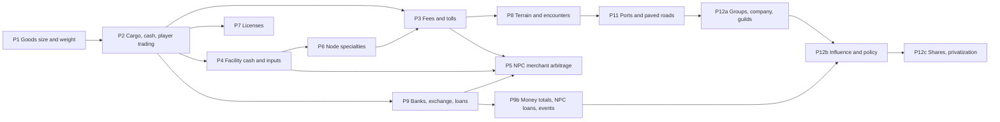

# Economy rules implementation plan

Order follows dependencies: cargo is needed by trading, trading by costs, and all of them by merchants.
Each phase ends with EditMode tests (determinism, save/load, Burst parity where a job is involved).

| Phase | Scope | Systems | Ready? |
|---|---|---|---|
| P1 | `weight`/`size` per base good in goods data and native arrays; capacity helper | SYS-INVENTORY | Done |
| P2 | `CargoTable` (cart, warehouses), cash per continent coin, buy/sell commands at current price, partial fills, placeholder capacities, random village start, save migrations | SYS-INVENTORY, SYS-PLAYER-START | Done (cart only; warehouses come with P4, license check with P7) |
| P3 | Base fee per trip, per-unit charge, toll on every entered node valued at local prices | SYS-TRAVEL-COSTS | Done |
| P4 | Facility cash, input purchase from stock, all-or-nothing, income at current price, bankruptcy (player facilities too), player output to warehouse with overflow sale | SYS-PRODUCTION | Done |
| P5 | Detailed arbitrage merchants with cargo, trips, costs, licenses, bankruptcy, loans; aggregate node-to-node flows with expected encounter loss | SYS-MERCHANTS | Done (loans with P9b, encounter loss with P8) |
| P6 | Terrain tags on nodes, tag-to-specialty table, four specialty effects | SYS-PRODUCTION | Done (placeholder data) |
| P7 | Per-good licenses issued by nations, yearly renewal, sell check, NPC holders | SYS-LICENSES | Done |
| P8 | Route terrain (turns, cost), encounter roll per trip, guards and insurance, passage and owned ships | SYS-ROUTE-HAZARDS | Done |
| P10 | Elasticity classes, demand weights (size, wealth, population), Pareto households, basic price index later | SYS-MARKETS | Ready; basket deferred (Q-030) |
| P9 | State-owned national and international banks, exchange with fee, deposits with interest and payment, player loans on any collateral, weekly repayment, seizure and auction, finite reserves | SYS-BANKING | Done |
| P9b | NPC loans (facilities, merchant groups), money totals per nation and continent, reserve-driven loan rates, quarterly records and yearly statistics, financial events | SYS-BANKING | Ready |
| P11 | Ports (ship trade, port-only water routes, docked ships), paved roads (condition, cheaper and safer travel, map roads, player building, upkeep and decay) | SYS-INFRASTRUCTURE | Done |
| P12a | Interest groups owning facilities and merchant groups, the player's company, guild membership with cheaper insurance, guild hall warehouses and cheaper licenses | SYS-INTEREST-GROUPS | Ready |
| P12b | Influence (assets, lobbying, members and jobs), yearly weighted policy review of tolls, licenses and minting, player lobbying | SYS-INTEREST-GROUPS | After Q-035 and P9b |
| P12c | Company shares, privatization of state enterprises | SYS-INTEREST-GROUPS | Later (DEC-056) |

## Notes
- P2 changes the player's cash into per-continent coin balances. Until P9 exists the player simply cannot
  obtain foreign coins, which is consistent with DEC-031.
- P6 feeds P3: the toll surcharge applies to a node's specialty categories. P3 can start with base rates.
- Tolls on every entered node and per-trip cost evaluation make P5 the heaviest phase at full scale
  (9,250 merchant groups): keep detailed merchants to the LOD region and run the aggregate flow pass as a
  Burst job from the start.
- Placeholder numbers (capacities, rates, effect sizes, loss ratios, prices) go to `config.csv` / data
  files marked [Draft]; they block balance, not code.
- P1 to P9 and P11 are done. Next: P9b (money totals, NPC loans, events), P10 (market demand) or P12a
  (interest groups); P12b waits for Q-035 and P9b.
- With P5 a full-scale turn takes about 14.7 ms (7.8 ms before); running aggregate merchants on the market
  tier cadence would cut it if mobile needs it.
- Since P4, city workshops buy inputs only from stock, and no merchant carries village ore to cities yet,
  so smithies stay idle until P5.
