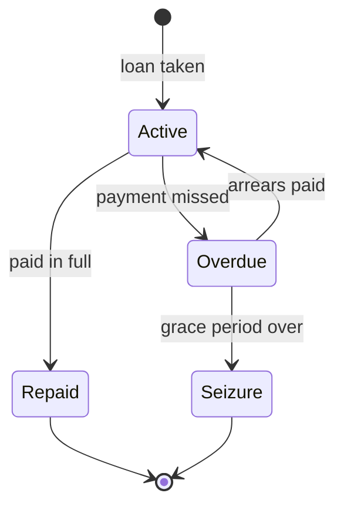

# Banks, exchange and loans

## Purpose
Money has a place: national banks hold it, international banks change it, and loans let the business grow
faster than its cash at the risk of losing what it owns.

## Rules
- [Confirmed] Each nation runs a bank with one branch in every node of city level and above (DEC-032).
- [Confirmed] National banks belong to their nation and international banks to their continent (DEC-041).
- [Confirmed] Money is aggregated as each nation's total and each continent's total (DEC-041).
- [Confirmed] A nation's branches are linked: money deposited at one branch is available at the others in
  that nation (DEC-032).
- [Confirmed] Each continent has one international bank, in a city designated in the map data (DEC-032,
  DEC-036).
- [Confirmed] At the international bank's node, coins are exchanged at the exchange rate, minus a fee whose
  rate is a config value (DEC-032, DEC-036).
- [Confirmed] Deposits earn interest at a config rate (DEC-036).
- [Confirmed] At nodes with a branch, purchases can be paid from deposits (DEC-036).
- [Confirmed] Cash is carried in continents' coins; foreign coins are obtained only by exchanging at an
  international bank (DEC-031).
- [Confirmed] Exchange rates follow each continent's price index, so an inflating continent's coin weakens
  (DEC-030).
- [Confirmed] Banks lend to the player, NPC facilities and NPC merchant groups (DEC-033, DEC-037).
- [Confirmed] The loan limit is based on the value of collateral (DEC-037). Besides facilities, bank
  deposits, owned ships, cargo stored in warehouses and cargo on the cart count (DEC-038).
- [Confirmed] Villages have no bank, so a new player cannot borrow at first (DEC-040).
- [Confirmed] Loans are repaid in weekly instalments; interest rate and term are config values (DEC-037).
- [Confirmed] After a grace period, an unpaid loan leads to seizure of the collateral (DEC-037, DEC-038).
- [Confirmed] A seized facility is auctioned; the player may bid. With no winning bid it is sold to a new
  NPC operator (DEC-039).
- [Confirmed] Proceeds left after repaying the debt go to the bank, not the former owner (DEC-039).
- [Draft] Interest rates, fee rate, loan-to-value ratio, term and grace period start as placeholder
  config values.
- [Draft] Collateral valuation (facility value, cargo at local market price) and the auction length and
  reserve price start as placeholder config values.
- [Confirmed] A nation's total counts held cash (in transit included), deposits and bank reserves; cash
  counts toward the nation where it is now (DEC-042).
- [Confirmed] Yearly minted coins go to the international bank, which distributes them to national banks
  (DEC-042).
- [Confirmed] Totals drive loan interest, the price index (continent total) and financial events (DEC-042).
  Until households spend (P13b) the index follows the coin supply; then the published continent total
  (DEC-062; built in P13d: the index is the published total over the total at world start, which equals
  the starting coin supply, so a year's minting reaches prices with the next year's statistics).
- [Confirmed] Money is created only by minting (DEC-061). Tolls and license prices go to the nation's
  reserve; the state spends reserves above a target as public wages; auction buyers and new operators
  pay from their group's cash; withdrawals in a bank run go to the nation's households (DEC-061).
- [Draft] Claude's proposals, built in P13a (money conservation) and P13b (households and floats):
  - Traders hold one float per nation; a continent's own float covers nodes above nation level. Markets
    pay sellers out of the float where the seller stands, never more than it holds, and buyers pay into
    it. Households hold cash per node; wages and fees go to them (SYS-MARKETS).
  - At the start, each international bank gets 2% of its continent's coin supply
    (`bank.international_reserve_permille`); of the rest of the supply nobody holds, the nations' floats
    get 90% (previous: 10%, DEC-094; `markets.trader_float_permille`, split by the nations' population) and
    the households the rest (by each node's population), so that each continent's money equals its coin supply.
  - Households lend to their nation's float while traders keep up their payments (DEC-092, DEC-094): 1% a week
    of their cash beyond 26 weeks of spending, at 5% a year, paid back over 52 weeks within 25% of the float
    (`traders.*`). The bank can lend the same way; it does not in the sample data.
  - Traders pay sellers the price less their margin. A float above eight weeks of households' wishes pays 2% a week of
    the excess to the nation's households (DEC-098).
  - Credit among NPCs (DEC-097; the player has no commands for it yet):
    - Traders who cannot pay a merchant give a bill, due in 8 weeks, up to 8 weeks of households' wishes less what
      they owe. The bank pays the seller the face less 2% as far as it has coins above half its reserve target;
      otherwise the seller holds it. Due bills are paid from at most 25% of the float a week, and a bill 26 weeks
      overdue is protested at the holder's loss. Those lost claims are no coins, so a continent's money stands.
    - A nation whose towns fall short of necessities sells bonds for the shortfall, up to 30% of its share of the
      coin supply, and pays the towns with the coins: 4% a year over 20 years, from its spendable reserve. It sells none
      while behind on them or in a credit crunch.
    - A group feeds a facility short of 4 weeks of working cash, if its output is worth more than its inputs, from its
      own money above its starting cash, then from bonds up to 50% of its facilities' value: 7% a year over 10 years.
      26 weeks behind, it defaults and its holders lose what is left.
    - The player trades bonds only, at the issuer's bank, never bills; what they pay goes to the player's account (DEC-102).
    - Banks sell merchants price cover (DEC-099, SYS-MERCHANTS).
    - Bonds are bought by households, 0.5% a week of their cash beyond 26 weeks of spending, and by groups, 0.5% a week of
      their cash beyond twice their starting cash. `BillTable`, `BondTable` and `BillRoom` are saved.
  - Nations keep their international bank between 2% and 4% of the coin supply, out of and into their reserves, so a
    one-sided surplus on trade does not stop the trade (DEC-096).
  - Exchange takes the coins handed in into their continent's international bank and pays the coins
    handed out from theirs, and is refused when that bank lacks them. A payment that settles a debt in
    another continent's coin (seized deposits, cargo sold for a foreign lender, an auction abroad) moves
    the value through both international banks.
  - A new operator's arrival settles the old operator's cash with the nation's households by population
    (arrears are wages and bills they never get); the starting cash comes from the owning group, then
    those households. (P13d: charged to the node's households alone, the cities where firms are based
    went into debt and stopped buying; outside any nation, the node's households.) A seized ship is bought by the lending nation's traders. Robbed coins go to the households
    where the trip began. Insurance premiums go to the lowest-numbered guild of the origin city (else its
    households); refunds come from that guild's cash, then the households. Facility sale proceeds go to
    the seller's group; the company's founding money becomes its cash. A ship is bought from and sold back
    to the port's households. Bank-run withdrawals go to the nation's households by population.
  - Seized cargo and a defaulted merchant's cargo are sold only as far as the traders there can pay; the
    rest stays where it was.
  - Measured in the sample world over eight years (continent 0): each continent's money equals its coin
    supply every turn. Households start with 3.1M and spend down to about 1.2M by year 4; the floats run
    dry in the third year and then cap payouts, so facility cash (1.4M) and reserves (4.5M by year 8)
    hold what they collect. Prices sit at about 2 to 2.9 times their base price. Dividends and state
    spending (P13c) are what return that money to households.
- [Draft] Claude's proposals, built in P13c (state spending):
  - A nation's reserve target is twice its share of the initial reserve share of the current coin supply
    (`bank.state_reserve_target_permille`, 2000; 10% of the supply split evenly over the continent's
    nations). Each week the state spends 2% of its reserve above the target and the player's deposits
    (`bank.state_spending_permille`) as public wages to the nation's households, by population.
  - Measured in the sample world over ten years (continent 0) with dividends and state spending: money
    circulates. Households fall from 3.1M to 2.2M in year 2 and recover to 4.0M by year 9; floats hold
    0.33 to 0.6M; facility cash stays near 0.2M; groups grow from 0.15M to 0.55M; reserves settle near
    2.2M against a target of about 1.7M. To retune in P13d: prices climb from 1.1 to 3.9 times their base
    price (the coin supply index reaches 1.66); population falls about 2.7% a year (necessities priced
    out in 7 of 18 populated nodes, whose budgets bind); derived income per head falls to about a tenth of
    the starting parameter; NPC loan defaults run at 100 to 160 a year.
- [Draft] Claude's retuning, P13d (sample world, ten years, both continents unless noted):
  - Diagnosis: the 3.9x average price came from goods nobody sells, which sit at their choke price;
    stocked goods traded at 0.5 to 0.8 of their anchor. Population fell because its need counted goods no
    market offered (half the people live at continent and nation nodes, where nothing is ever stocked)
    and because cities' households carried every failed firm's start-up cash. Most defaults came from
    four smithies per city glutting tools (977 in stock at one city, at a tenth of the anchor) and from
    bakeries in villages without wheat.
  - Changes: the index from published totals; population needs count usually traded goods (DEC-067);
    operator funding spread over the nation; routes up to nation and continent markets (DEC-068);
    input-aware spawning and more demand for tools (DEC-069); income per head defaults near measured
    income (SYS-MARKETS).
  - Result (continent 0): the index runs 1.00 to 1.67 with the minting; stocked goods trade at 0.7 to 1.1
    of their anchor; population falls about 1.0% a year (was 2.7%); households hold 2.5 to 2.7M, facilities
    0.27M, reserves settle near 2.1M. NPC defaults run at about 25 in year 1 and 80 to 130 a year later
    (both continents); merchant bankruptcies fall from about 28 to about 5 a year.
  - Left for later:
    - Floats grow to 1.6M and groups to 1.2M: floats have no outflow but sales (a rule is undecided), and
      P16 invests groups' cash.
    - City and region budgets bind at 3 to 22%: they earn about 1,000 coins a week and wish for about 4,500,
      while villages hold 24 to 225k. This is why smithies still default 330 times in ten years, and why
      population falls.
    - Continent nodes still get no goods: the nation's households buy what arrives first, so their 1.2M
      stays idle in the sample world.
- [Confirmed] Financial state is recorded quarterly; statistics are published yearly, and NPC agents use the
  same published statistics at the same time (DEC-043).
- [Confirmed] Banks lend only from their reserves; a nation can run out of credit (DEC-046).
- [Confirmed] Financial events trigger with a low random probability (DEC-044).
- [Confirmed] Effects: bank run limits withdrawals, credit crunch stops new loans, loan rates spike (DEC-044).
- [Confirmed] An event lasts until conditions recover, at least one quarter (DEC-044).
- [Confirmed] Published statistics include the price index and inflation (DEC-044).
- [Confirmed] An event ends when the reserve ratio returns above a config threshold, after at least one
  quarter (DEC-047).

- [Draft] Placeholders: starting reserves 10% of each continent's coin supply split over its nations;
  deposit interest 2% a year; exchange fee 3%; loan interest 10% a year, 52-week term, loan-to-value 50%;
  grace 4 weeks; auction 2 weeks with a reserve price of 80% of the facility's value; facility values
  3,000 / 8,000 / 5,000 per tier and level (`bank.*`, `facility.<tier>.value`).
- [Draft] Claude's proposals, built in P9:
  - Deposits sit in the bank's reserve, so a withdrawal needs both the balance and the bank's coins.
  - Minted coins are split evenly over the continent's nations; the remainder stays with the
    international bank, which also keeps exchange fees.
  - An international bank changes its own continent's coin into another's and back.
  - Loan interest for the whole term is added up front, repaid in equal weekly instalments; one loan per
    bank at a time; early repayment is allowed at a branch.
  - Instalments are taken automatically, from the deposit with the lender first, then from the coins of
    that continent the player carries, wherever they are.
  - Seizure takes deposits (any bank), then warehouse cargo, then the cart (at one of the lender's
    branches), then facilities, until the debt is covered. Cargo is sold at the nearest market; what
    exceeds the debt goes to the bank. Debt left after all assets stays owed. Only auctions for the
    player's own loan count as covering it. A deposit is taken only as far as its bank still holds the
    coins (DEC-107).
  - A winning bid is paid when the auction closes, from the coins and then the deposits of the
    facility's continent, as far as their banks hold the coins (DEC-107); without a winning bid an NPC
    buys at the reserve price.
- [Draft] Claude's proposals, built in P9b:
  - A nation's money total is the positive cash held at its nodes (player, merchant groups, facilities,
    interest groups) plus its bank's reserve; deposits sit in the reserve and are not added again. Coins
    held outside any nation (carried abroad, or at continent-level nodes) count only toward their
    continent's total, as does the international bank's reserve. A merchant group's coins are its home
    continent's, wherever it is (DEC-107).
  - Reserve ratio = reserve / (reserve + loan balances owed to the bank, the player's and NPCs'). It is
    1.0 for a bank that has lent nothing.
  - Loan rate = base rate (10%) times target ratio / reserve ratio when the ratio is below the target
    (50%), capped at 3 times the base; taken at each quarter's end and used for all new loans
    (`bank.target_reserve_permille`, `bank.max_rate_multiplier_permille`).
  - NPC facilities and merchant groups whose cash ended a week below zero borrow the shortfall plus 8
    weeks of upkeep from their nation's bank, up to 50% of their collateral: the facility's value, or the
    cargo a merchant group carries at nearest-market prices (an idle, empty group gets nothing). One loan
    per borrower, at most 10% of the bank's reserve each, repaid over 26 weeks
    (`bank.npc_buffer_weeks`, `bank.npc_max_reserve_share_permille`, `bank.npc_loan_term_weeks`).
  - NPC instalments come out of the borrower's cash. After the grace period a facility is seized and
    auctioned (the player may bid; the proceeds go to the bank); a merchant group's cargo is sold at the
    nearest market and the rest is written off. An NPC facility going bankrupt with a loan is seized the
    same way; a merchant group going bankrupt leaves its loan unpaid. Buying an NPC facility costs at
    least its value and the cash it holds (DEC-107) and repays its loan from the price; the bank writes
    off what the price does not cover.
  - Quarters are 13 weeks; a record is taken in the last week of each quarter (turns 12, 25, 38, 51 of a
    year), and the last 20 records are kept (`finance.history_quarters`). Each new year publishes, from the
    last record, every nation's total, reserve ratio and loan rate and every continent's total, price
    index and inflation (change of the price index since the previous publication).
  - Financial events: 2% chance per nation and quarter (`finance.event_chance_permille`), one of bank run,
    credit crunch and rate spike with equal chance. A bank run takes 20% of the reserve out at once (the
    public's withdrawals) and lets the player withdraw at most 10% of the deposit, once a week; a credit
    crunch stops new loans to the player and NPCs; a rate spike doubles the loan rate. An event ends at a
    quarter's end at least 13 weeks after it began once the reserve ratio is 50% or more
    (`finance.bank_run_drain_permille`, `finance.bank_run_withdraw_permille`, `finance.rate_spike_permille`,
    `finance.event_end_reserve_permille`).
  - The price index still follows the minted coin supply; measured totals do not drive it yet (Q-036).

## Flow (loan)

## Edge cases
- Player in a village (no branch): no deposit or withdrawal there until reaching a city or above.
- Player on another continent without that continent's coins: must reach the international bank first, or
  sell goods for local coins.

## Unity implementation notes
P9 built the player's banking; P9b added NPC loans, money totals, records, statistics and financial events.
- `NodeBanks` (world component): branches are the nodes from nation down to city level; the international
  bank is the `international_bank` flag in `map_nodes.csv` (Claude-chosen name, [Draft]), at most one per
  continent, on a branch.
- Persistent `BankState` (reserves and player deposits per nation, international reserves, coin supply
  already distributed), `LoanTable` and `AuctionTable`. `BankSystem` runs Late in the Finance phase:
  minted-coin distribution, deposit interest, instalments, seizure, auction close.
- Commands: `BankTransferCommand` (deposit / withdraw), `ExchangeCommand`, `TakeLoanCommand`,
  `RepayLoanCommand`, `BidCommand`; `BuyGoodsCommand` can pay from the deposit at a branch.
  `PlayerBalanceSheet` values collateral and debt for limits and seizure. A seized facility belongs to
  `OwnerIds.Bank` until its auction closes; it keeps producing like an NPC facility. It cannot go bankrupt while held (DEC-109).
- `NpcLoanTable` (persistent, with a borrower lookup) holds NPC loans; `BankSystem` services them and lends
  to NPCs below zero each week (a managed scan, about 0.3 ms per full-scale turn). `NpcLending` holds the
  shared lending and seizure steps; `AuctionTable` (version 2) marks whether a sale repays the player's
  loan.
- `CurrencyState` version 3 (P13d) holds each continent's published money total and its baseline;
  `FinanceSystem` sets the total when it publishes, and the currency model prices on it the turn after.
  A version 2 save starts both at its coin supply figures.
- `PurseState` (persistent, version 2 since P13b) holds the traders' floats and each node's float, with
  `Payable` and `Sellable` for capped payouts; `MoneyLedger` routes the payments above, seeds floats and
  households and audits a continent's money (`ContinentMoney`), which `MoneyTests` checks every turn
  against the coin supply. `MoneyTotals` counts floats and household cash as cash held in the nation.
  [Draft] A P13a save keeps its purses as floats and gets the freshly seeded household cash of a new
  game, so its money grows once.
- `MoneyTotals` (not saved) computes the totals at each quarter's end, and on demand for the view.
  `FinanceState` (persistent) holds each nation's loan rate and event, the quarterly `FinanceRecord`s and
  the published statistics; `FinanceSystem` runs after `BankSystem` (about 0.7 ms per full-scale turn on
  average). The view exposes totals, rates, events, records and published statistics.
- Seizing cart cargo happens when the borrower is next at a node with a branch of the lending nation
  ([Draft], Claude's proposal; a moving cart has no fixed place).
- Loan servicing runs in the Finance phase next to `CurrencySystem`; seizure changes facility ownership
  through the same path as `BuyFacilityCommand`, so LOD and guidance react.

