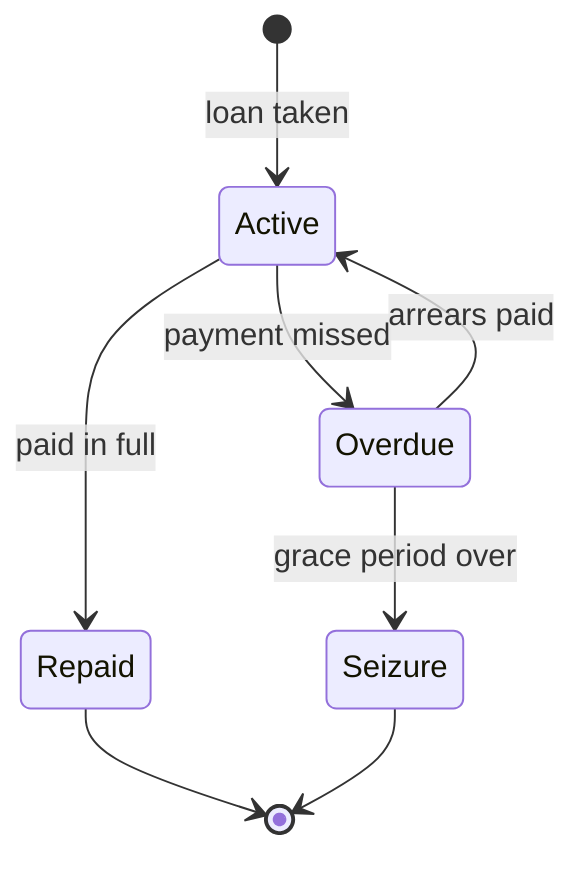

# Banks, exchange and loans

## Purpose
Money has a place: national banks hold it, international banks change it, and loans let the business grow
faster than its cash at the risk of losing what it owns.

## Rules
- [Confirmed] Each nation runs a bank with one branch in every node of city level and above (DEC-032).
- [Confirmed] National banks belong to their nation and international banks to their continent (DEC-041).
- [Confirmed] Money is aggregated as each nation's total and each continent's total (DEC-041).
- [Confirmed] A nation's branches are linked: money deposited at one branch is available at the others in
  that nation (DEC-032).
- [Confirmed] Each continent has one international bank, in a city designated in the map data (DEC-032,
  DEC-036).
- [Confirmed] At the international bank's node, coins are exchanged at the exchange rate, minus a fee whose
  rate is a config value (DEC-032, DEC-036).
- [Confirmed] Deposits earn interest at a config rate (DEC-036).
- [Confirmed] At nodes with a branch, purchases can be paid from deposits (DEC-036).
- [Confirmed] Cash is carried in continents' coins; foreign coins are obtained only by exchanging at an
  international bank (DEC-031).
- [Confirmed] Exchange rates follow each continent's price index, so an inflating continent's coin weakens
  (DEC-030).
- [Confirmed] Banks lend to the player, NPC facilities and NPC merchant groups (DEC-033, DEC-037).
- [Confirmed] The loan limit is based on the value of collateral (DEC-037). Besides facilities, bank
  deposits, owned ships, cargo stored in warehouses and cargo on the cart count (DEC-038).
- [Confirmed] Villages have no bank, so a new player cannot borrow at first (DEC-040).
- [Confirmed] Loans are repaid in weekly instalments; interest rate and term are config values (DEC-037).
- [Confirmed] After a grace period, an unpaid loan leads to seizure of the collateral (DEC-037, DEC-038).
- [Confirmed] A seized facility is auctioned; the player may bid. With no winning bid it is sold to a new
  NPC operator (DEC-039).
- [Confirmed] Proceeds left after repaying the debt go to the bank, not the former owner (DEC-039).
- [Draft] Interest rates, fee rate, loan-to-value ratio, term and grace period start as placeholder
  config values.
- [Draft] Collateral valuation (facility value, cargo at local market price) and the auction length and
  reserve price start as placeholder config values.
- [Confirmed] A nation's total counts held cash (in transit included), deposits and bank reserves; cash
  counts toward the nation where it is now (DEC-042).
- [Confirmed] Yearly minted coins go to the international bank, which distributes them to national banks
  (DEC-042).
- [Confirmed] Totals drive loan interest, the price index (continent total) and financial events (DEC-042).
- [Confirmed] Financial state is recorded quarterly; statistics are published yearly, and NPC agents use the
  same published statistics at the same time (DEC-043).
- [Confirmed] Banks lend only from their reserves; a nation can run out of credit (DEC-046).
- [Confirmed] Financial events trigger with a low random probability (DEC-044).
- [Confirmed] Effects: bank run limits withdrawals, credit crunch stops new loans, loan rates spike (DEC-044).
- [Confirmed] An event lasts until conditions recover, at least one quarter (DEC-044).
- [Confirmed] Published statistics include the price index and inflation (DEC-044).
- [Confirmed] An event ends when the reserve ratio returns above a config threshold, after at least one
  quarter (DEC-047).

## Flow (loan)

## Edge cases
- Player in a village (no branch): no deposit or withdrawal there until reaching a city or above.
- Player on another continent without that continent's coins: must reach the international bank first, or
  sell goods for local coins.

## Unity implementation notes
- Branches need no new map data: every node of city level and above has one; the nation is
  `NodeTable.AncestorAt(node, Nation)`. The international bank city is a `map_nodes.csv` flag
  (Claude-chosen name `international_bank`, [Draft]).
- NPC loans at full scale (8,500 facilities, 9,250 merchant groups) belong in a Burst job over a loan
  table, not per-entity managed code.
- A persistent `BankTable` holds accounts per (holder, nation) and loans per (holder, bank); exchange reads
  `CurrencyState.ExchangeRate`, which already follows the price index.
- Seizing cart cargo happens when the borrower is next at a node with a branch of the lending nation
  ([Draft], Claude's proposal; a moving cart has no fixed place).
- Loan servicing runs in the Finance phase next to `CurrencySystem`; seizure changes facility ownership
  through the same path as `BuyFacilityCommand`, so LOD and guidance react.

