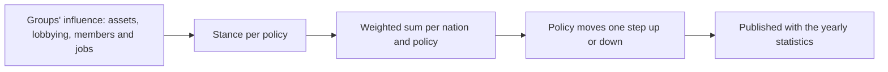

# Economic interest groups

## Purpose
The economy has owners with interests. Companies, guilds, state enterprises and private businesses own
the facilities and merchant groups, compete for markets, and push nations' policy their way, so the
player meets rivals and allies instead of an anonymous market.

## Rules
- [Confirmed] Interest groups are both asset owners (facilities, merchant groups, cash) and political
  forces that influence policy such as tariffs and licenses (DEC-055).
- [Confirmed] Company: a large business with facilities and merchant groups across regions; the player's
  company is one (DEC-055).
- [Confirmed] Guild: an association per city and trade, with membership; it runs the insurance, guild
  hall warehouses and license recommendations (DEC-055).
- [Confirmed] State enterprise: owned by a nation; the state banks and monopolies on strategic goods such
  as mines (DEC-055, DEC-041).
- [Confirmed] Private enterprise: a small business owned by a person or family, as today's NPC facilities
  and merchant groups are (DEC-055).
- [Confirmed] At the start every NPC facility and merchant group belongs to an interest group (DEC-055).
- [Confirmed] The player founds a company; the existing founding command creates it (DEC-056).
- [Confirmed] The player can join guilds for a fee (DEC-056).
- [Confirmed] Company shares and bids for privatized state enterprises come in a later phase (DEC-056).
- [Confirmed] Guild members get cheaper insurance, the city's guild hall warehouse, and a guild
  recommendation that makes licenses in its trade cheaper (DEC-057).
- [Confirmed] Groups can move toll and specialty surcharge rates, licensed goods and license prices, and
  the minting rate (DEC-058).
- [Confirmed] Influence comes from asset value, lobbying spending, and membership and employment
  (DEC-058).
- [Confirmed] Each nation reviews policy once a year and moves each policy one step, weighted by
  influence (DEC-058).
- [Confirmed] The player can lobby in their company's name (DEC-058).
- [TBD] Which way each kind of group pushes each policy (Q-035).

## Flow (yearly policy review)

## Unity implementation notes
Planned as P12a (groups, ownership, company, guild membership and benefits), P12b (influence and the
yearly policy review, after Q-035) and P12c (shares, privatization).
- A persistent `GroupTable` (kind, home node, nation, cash, influence) and an owner group column on
  `FacilityTable` and `AgentTable`, replacing the plain NPC owner; `OwnerIds.Player` stays the player.
- Existing per-entity cash stays where it is; group cash funds expansion, road building and lobbying.
- `FoundCompanyCommand` creates the player's company row.
- The review runs with the yearly statistics (DEC-043), so policy changes and published figures line up.
- The minting rate becomes per continent (today one config value for all), since it is set by the
  nations' reviews.
