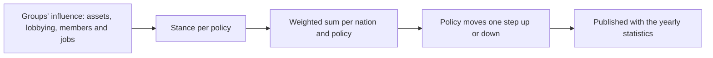

# Economic interest groups

## Purpose
The economy has owners with interests. Companies, guilds, state enterprises and private businesses own
the facilities and merchant groups, compete for markets, and push nations' policy their way, so the
player meets rivals and allies instead of an anonymous market.

## Rules
- [Confirmed] Interest groups are both asset owners (facilities, merchant groups, cash) and political
  forces that influence policy such as tariffs and licenses (DEC-055).
- [Confirmed] Company: a large business with facilities and merchant groups across regions; the player's
  company is one (DEC-055).
- [Confirmed] Guild: an association per city and trade, with membership; it runs the insurance, guild
  hall warehouses and license recommendations (DEC-055).
- [Confirmed] State enterprise: owned by a nation; the state banks and monopolies on strategic goods such
  as mines (DEC-055, DEC-041).
- [Confirmed] Private enterprise: a small business owned by a person or family, as today's NPC facilities
  and merchant groups are (DEC-055).
- [Confirmed] At the start every NPC facility and merchant group belongs to an interest group (DEC-055).
- [Confirmed] The player founds a company; the existing founding command creates it (DEC-056).
- [Confirmed] The player can join guilds for a fee (DEC-056).
- [Confirmed] Company shares and bids for privatized state enterprises come in a later phase (DEC-056).
- [Confirmed] Guild members get cheaper insurance, the city's guild hall warehouse, and a guild
  recommendation that makes licenses in its trade cheaper (DEC-057).
- [Confirmed] Groups can move toll and specialty surcharge rates, licensed goods and license prices, and
  the minting rate (DEC-058).
- [Confirmed] Influence comes from asset value, lobbying spending, and membership and employment
  (DEC-058).
- [Confirmed] Each nation reviews policy once a year and moves each policy one step, weighted by
  influence (DEC-058).
- [Confirmed] The player can lobby in their company's name (DEC-058).
- [Confirmed] Guilds, companies and private enterprises take their stance on tolls and licenses from their
  own trade: protection where they produce, open trade where they buy; protection for licenses they hold,
  relief for licenses they lack (DEC-059).
- [Confirmed] Of all groups only state enterprises take a side on minting: they push it up (DEC-059).
- [Confirmed] State enterprises push tolls up and licenses wider and dearer, protecting their monopolies
  (DEC-059).
- [Confirmed] Stances change with a group's business: a group losing money leans toward protection
  (DEC-059).

## Stances
| Kind | Tolls and surcharges | Licensed goods and prices | Minting |
|---|---|---|---|
| Guild | Own trade | Own trade | No side |
| Company | Own trade | Own trade | No side |
| State enterprise | Up | Wider and dearer | Up |
| Private enterprise | Own trade | Own trade | No side |

"Own trade": up where the group produces, down where it buys; protect licenses it holds, relax licenses
it lacks. Losses tilt every group with an "own trade" stance toward protection.

## Flow (yearly policy review)

## Unity implementation notes
P12a (groups, ownership, company, guild membership and benefits) is built; P12b (influence and the yearly
policy review) and P12c (shares, privatization) are not.
- [Draft] (Claude's proposals, built in P12a):
  - Start: one state enterprise and two companies per nation; a guild per city for every trade (goods
    category) that the city's or its villages' facilities produce; a private enterprise per node with
    assets left over.
  - Owners: facility types marked `state_owned` in `facilities.csv` (sample: mines) belong to the
    nation's state enterprise; workshops (secondary tier) and merchant groups based at region level and
    above to the nation's companies in turn; everything else to the private enterprise of its node.
  - A bankrupt NPC facility stays with its group under a new manager; a player facility lost to
    bankruptcy, or a seized one no bid wins, goes to the private enterprise of its node.
  - Guild fee 200 a year (to the guild's cash). Insurance is 30% cheaper on trips starting in a city (or
    its village) where the player belongs to any guild; licenses are 30% cheaper with membership of a
    guild of the good's trade anywhere in the nation. Guild hall: 1,000 weight / 800 size per guild;
    goods stay there when membership lapses, usable again after renewing; hall goods count as collateral
    and are seized after facility warehouses.
  - Group cash does nothing yet; P12b spends it on lobbying.
- [Draft] (Claude's proposal) "Where it produces" and "where it buys" are a nation's markets where the
  group's facilities sell output and buy inputs; a stance is the signed balance of those volumes per
  policy. The loss tilt grows with the share of the group's cash lost over the last year.
- Persistent `GroupTable` (kind, home node, trade, cash, player flag) and `GuildMembershipTable`; a
  `Group` column on `FacilityTable` and `AgentTable` (section version 3, `GroupColumnMigration`), next to
  the existing owner flag; `GroupSystem.OnLoaded` gives owners to rows from older saves. `GroupSetup`
  founds and assigns; `GroupDirectory` looks groups up.
- `FoundCompanyCommand` creates the player's company (once) and makes it the group of the player's
  facilities; facilities bought later join it. `JoinGuildCommand`, `MoveGuildHallCargoCommand` and
  `GuildBenefits` cover membership; `GroupSystem` drops lapsed memberships (`GuildMembershipExpired`).
- Existing per-entity cash stays where it is; group cash funds expansion, road building and lobbying.
- The review runs with the yearly statistics (DEC-043), so policy changes and published figures line up.
- The minting rate becomes per continent (today one config value for all), since it is set by the
  nations' reviews.
