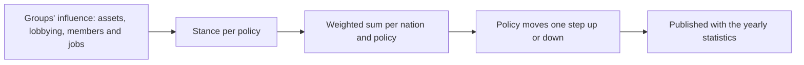

# Economic interest groups

## Purpose
The economy has owners with interests. Companies, guilds, state enterprises and private businesses own
the facilities and merchant groups, compete for markets, and push nations' policy their way, so the
player meets rivals and allies instead of an anonymous market.

## Rules
- [Confirmed] Interest groups are both asset owners (facilities, merchant groups, cash) and political
  forces that influence policy such as tariffs and licenses (DEC-055).
- [Confirmed] Company: a large business with facilities and merchant groups across regions; the player's
  company is one (DEC-055).
- [Confirmed] Guild: an association per city and trade, with membership; it runs the insurance, guild
  hall warehouses and license recommendations (DEC-055).
- [Confirmed] State enterprise: owned by a nation; the state banks and monopolies on strategic goods such
  as mines (DEC-055, DEC-041).
- [Confirmed] Private enterprise: a small business owned by a person or family, as today's NPC facilities
  and merchant groups are (DEC-055).
- [Confirmed] At the start every NPC facility and merchant group belongs to an interest group (DEC-055).
- [Confirmed] The player founds a company; the existing founding command creates it (DEC-056).
- [Confirmed] The player can join guilds for a fee (DEC-056).
- [Confirmed] Company shares and bids for privatized state enterprises come in a later phase (DEC-056).
- [Confirmed] Guild members get cheaper insurance, the city's guild hall warehouse, and a guild
  recommendation that makes licenses in its trade cheaper (DEC-057).
- [Confirmed] Groups can move toll and specialty surcharge rates, licensed goods and license prices, and
  the minting rate (DEC-058).
- [Confirmed] Influence comes from asset value, lobbying spending, and membership and employment
  (DEC-058).
- [Confirmed] Each nation reviews policy once a year and moves each policy one step, weighted by
  influence (DEC-058).
- [Confirmed] The player can lobby in their company's name (DEC-058).
- [Confirmed] Guilds, companies and private enterprises take their stance on tolls and licenses from their
  own trade: protection where they produce, open trade where they buy; protection for licenses they hold,
  relief for licenses they lack (DEC-059).
- [Confirmed] State enterprises push minting up; the other groups oppose it once prices have risen over
  the published year (DEC-060; previously no side, DEC-059).
- [Confirmed] State enterprises push tolls up and licenses wider and dearer, protecting their monopolies
  (DEC-059).
- [Confirmed] Stances change with a group's business: a group losing money leans toward protection
  (DEC-059).
- [Confirmed] Groups receive their facilities' profit above 26 weeks of costs (10% a week) and pass a share of
  it to the households of their home node (DEC-061; 50% by DEC-112; by income share, the top quintile 80%, by DEC-115).
- [Draft] Built in P13c: a group passes a share of the dividends it receives each week, 50% in the sample data (DEC-112),
  (`groups.payout_permille`) to the households of its home node; a state enterprise passes them to its nation's reserve instead. The rest stays in the
  group's cash for P16's investment. Merchant groups pay no dividends yet: their cash is their working
  capital.
- [Confirmed] Groups invest what they receive: new facilities, level-ups and road paving, at most one project
  per group a year; every kind of group may invest in anything (DEC-065).
- [Confirmed] Status-quo bias: each step a policy already stands from its start raises the weight it needs
  to move again by 100% of the base threshold (DEC-060).

## Stances
| Kind | Tolls and surcharges | Licensed goods and prices | Minting |
|---|---|---|---|
| Guild | Own trade | Own trade | Against when prices rose |
| Company | Own trade | Own trade | Against when prices rose |
| State enterprise | Up | Wider and dearer | Up |
| Private enterprise | Own trade | Own trade | Against when prices rose |

"Own trade": up where the group produces, down where it buys; protect licenses it holds, relax licenses
it lacks. Losses tilt every group with an "own trade" stance toward protection.

## Flow (yearly policy review)

## Unity implementation notes
P12a (groups, ownership, company, guild membership and benefits) and P12b (influence and the yearly
policy review) are built; P12c (shares, privatization) is not.
- [Draft] (Claude's proposals, built in P12a):
  - Start: one state enterprise and two companies per nation; a guild per city for every trade (goods
    category) that the city's or its villages' facilities produce; a private enterprise per node with
    assets left over.
  - Owners: facility types marked `state_owned` in `facilities.csv` (sample: mines) belong to the
    nation's state enterprise; workshops (secondary tier) and merchant groups based at region level and
    above to the nation's companies in turn; everything else to the private enterprise of its node.
  - A bankrupt NPC facility stays with its group under a new manager; a player facility lost to
    bankruptcy, or a seized one no bid wins, goes to the private enterprise of its node.
  - Guild fee 200 a year (to the guild's cash). Insurance is 30% cheaper on trips starting in a city (or
    its village) where the player belongs to any guild; licenses are 30% cheaper with membership of a
    guild of the good's trade anywhere in the nation. Guild hall: 1,000 weight / 800 size per guild;
    goods stay there when membership lapses, usable again after renewing; hall goods count as collateral
    and are seized after facility warehouses.
  - Group cash does nothing yet; P12b spends it on lobbying.
- [Draft] (Claude's proposals, built in P12b):
  - Policies and steps: per nation a toll step (every toll and specialty surcharge rate in the nation) and
    a license price step, each worth 10% of the map's or base value, at most 5 steps either way; per
    nation the set of licensed goods, starting from `goods.csv`, one good added or dropped per review; per
    continent a minting step (10% of the config minting rate each) (`policy.step_permille`,
    `policy.max_steps`).
  - Influence of a group in a nation: assets (facility values, merchant groups at their starting cash,
    positive cash of the group, its facilities and merchant groups) x 1, plus 50 per job (20 jobs per
    facility level, 10 per merchant group), plus 3 per coin lobbied that year. A guild counts the jobs and
    trade of the facilities in its city (and villages) that produce in its trade, not their assets.
    NPC groups spend 5% of their cash on lobbying each year; lobbying money goes to the nation's bank
    reserve (`policy.asset_weight_permille`, `influence_per_job`, `jobs_per_facility_level`,
    `jobs_per_merchant_group`, `lobby_weight_permille`, `npc_lobby_share_permille`).
  - Stances, measured from what a group's facilities make and use at full output, valued at base prices:
    tolls = (output - inputs) / (output + inputs), merchant groups counting their starting cash as
    toll-paying input. Per good: +1 if the group produces it, -1 if it uses it; on licensed goods its
    merchant groups add +0.5 when they hold licenses and -0.5 when they lack them. License price = the
    average of its stances on licensed goods it touches. State enterprises: +1 on everything. A group whose
    worth (its cash plus its holdings' cash) fell over the year adds twice the share lost toward
    protection, at most +1 (`policy.loss_tilt_permille`).
  - A policy moves one step when the influence-weighted sum of stances reaches 10% of the nation's total
    influence (the continent's for minting), raised by 100% of itself for every step the policy already
    stands from its start (licensed goods: per good added or dropped; DEC-060), without which the sample
    world pushed every policy to its limit within five years (`policy.move_threshold_permille`,
    `policy.resistance_permille`).
  - Opposition to minting: the continent's published inflation over 10% of a year, at most 1; at 10%
    inflation every group but the state enterprises is fully against (`policy.inflation_opposition_permille`).
  - The player lobbies with `LobbyCommand` in the company's name, inside the nation, from local coins: a
    policy, a direction and an amount (and a good for licensing). It counts at the next review.
  - In the sample world over six years: tolls settle at -2 steps (merchants and input buyers outweigh
    producers), license prices at +2 or +3, three goods become licensed; minting rises one step in the
    first year, then falls to -3 as inflation of 5 to 10% a year turns the other groups against it.
- `PolicyState` (persistent) holds steps, licensed goods per nation, worth at the last review and this
  year's lobbying; `PolicySystem` (Finance phase, after the statistics and households) reviews at each
  new year and reapplies toll rates after loading (`NodeTolls.ScaleNation`). `CurrencyState` (version 2)
  carries the minting multiplier. Licensing checks (player sales, license purchase, detailed and aggregate
  merchants) read the destination nation's list. The view exposes steps, licensing and influence; events
  `PolicyReviewed`, `MintingPolicyChanged`, `Lobbied`. The review takes about 34 ms once a year at full
  scale.
- Burst gotcha met here: a scalar field declared between the container fields of `MerchantFlowJob` was
  read as garbage under Burst; keep scalar fields first.
- [Draft] (Claude's proposal) "Where it produces" and "where it buys" are a nation's markets where the
  group's facilities sell output and buy inputs; a stance is the signed balance of those volumes per
  policy. The loss tilt grows with the share of the group's cash lost over the last year.
- Persistent `GroupTable` (kind, home node, trade, cash, player flag) and `GuildMembershipTable`; a
  `Group` column on `FacilityTable` and `AgentTable` (section version 3, `GroupColumnMigration`), next to
  the existing owner flag; `GroupSystem.OnLoaded` gives owners to rows from older saves. `GroupSetup`
  founds and assigns; `GroupDirectory` looks groups up.
- `FoundCompanyCommand` creates the player's company (once) and makes it the group of the player's
  facilities; facilities bought later join it. `JoinGuildCommand`, `MoveGuildHallCargoCommand` and
  `GuildBenefits` cover membership; `GroupSystem` drops lapsed memberships (`GuildMembershipExpired`).
- Existing per-entity cash stays where it is; group cash funds expansion, road building and lobbying.
- The review runs with the yearly statistics (DEC-043), so policy changes and published figures line up.
- The minting rate is per continent: the config rate times the continent's minting step.
