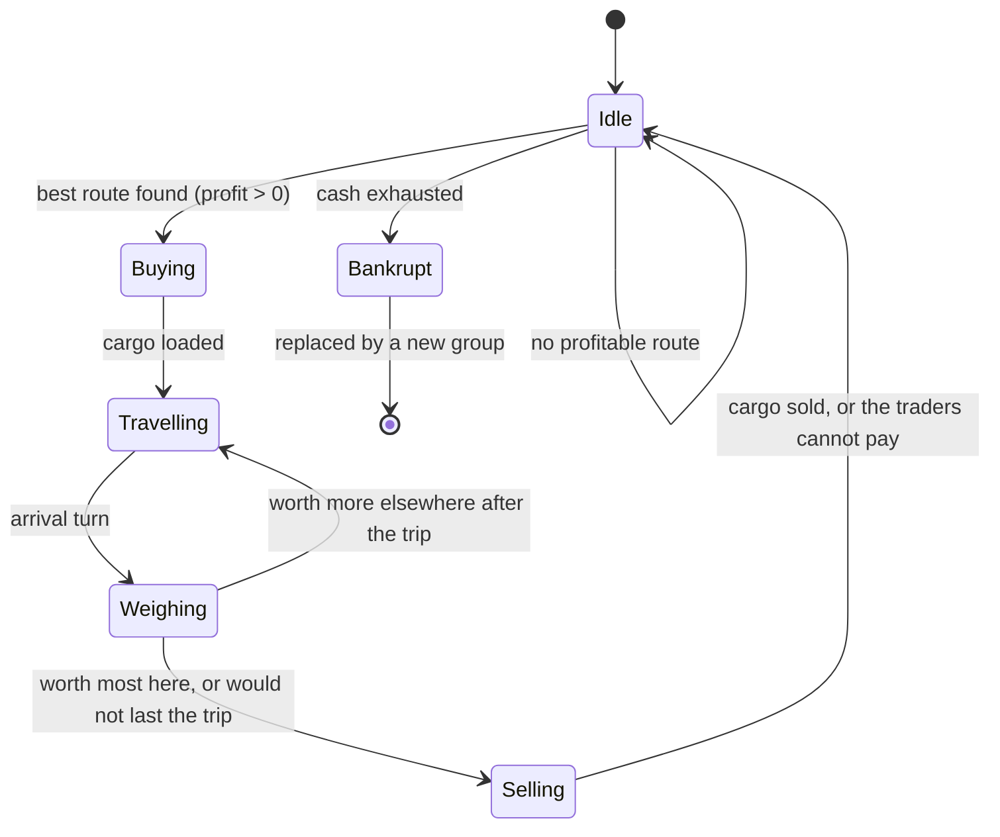

# NPC merchants

## Purpose
Merchant groups move goods between markets, so regional price gaps close over time and trade routes emerge
without scripting. Their counts per node are already in config (`merchants.<level>`).

## Rules
- [Confirmed] Merchants choose trades by arbitrage: buy where a good is cheap, sell where it is dear, when the
  price gap exceeds the transport cost (DEC-003).
- [Confirmed] Merchants carry real cargo, limited by size and weight capacity (DEC-003, DEC-009).
- [Confirmed] Merchant travel takes the route's travel turns; goods are in transit meanwhile (DEC-003).
- [Confirmed] Merchants of aggregate (far) nodes are not stepped one by one: trade between nodes is
  approximated as flows proportional to price gaps (DEC-003).
- [Confirmed] Merchants trade at the current price, their volumes feed supply and demand, and orders beyond
  stock fill partially, like the player (DEC-006, DEC-020).
- [Confirmed] When selling, traders pay the price less their margin, 25% in the sample data, and groups judge markets by that
  offer (previous: the price; DEC-098).
- [Confirmed] Merchants pay the same base fees, per-unit charges and tolls as the player (DEC-015).
- [Confirmed] A merchant group whose cash runs out goes bankrupt and is replaced by a new group (DEC-011).
- [Draft] Merchant capacity per level starts as placeholder config values (DEC-013).
- [Confirmed] Only some merchant groups hold licenses; the others cannot sell licensed goods (DEC-024).
- [Confirmed] Merchants in detailed regions roll encounters; far regions apply the expected loss (DEC-026).
- [Confirmed] Merchants read only the yearly published statistics, like the player (DEC-043).
- [Confirmed] Merchants need no ship for sea and river routes (DEC-034).
- [Confirmed] Merchant groups can borrow from banks (DEC-037).
- [Confirmed] A merchant group pledges deposits, warehouse cargo and cart cargo as collateral (DEC-038).
- [Confirmed] Large merchant groups trade between continents, changing coins at international banks;
  flows on routes between continents run at 65% of the normal flow share (DEC-066).
- [Draft] (Claude's reading of DEC-066, DEC-096) "Large" means groups based at region level or above that are not
  cautious, or are based at a port. Aggregate flows also cross continents at 65%, the margin taken after the
  exchange rate and fee. Abroad a group goes anywhere, buys no guards or insurance, and sells for coins only; what it
  earns and pays passes through both international banks. With nothing worth doing it sails home with what it holds.
- [Confirmed] Each continent makes its own goods, which stand only there (DEC-096).
- [Confirmed] The player can hire merchant groups (DEC-064, SYS-AUTOMATION).
- [Draft] Claude's proposals, built in P5:
  - A detailed group carries one good per trip along one route out of its node, choosing the most
    profitable load after the base fee, per-unit charge and toll; on arrival it sells the load or carries it on
    (DEC-093).
  - A group's cash is its home continent's coin, and it counts there wherever the group is (DEC-096).
  - Like facilities (DEC-051), a detailed group pays a weekly upkeep (50 / 40 / 30 / 20 / 10 per level of
    its home) and goes bankrupt after 5 weeks below zero (`merchants.<level>.upkeep`,
    `merchants.bankrupt_weeks`); aggregate groups pay none.
  - Aggregate flows move a share of the origin's stock (50%, `merchants.flow_permille`) times the margin
    over the destination price, within the node's pooled capacity, and arrive the same week, with no base
    fee; they lose the route's expected encounter share (P8). Between nations the destination's traders
    pay the origin's for the goods at the origin price, within their float (P13b, DEC-061).
  - A group arriving sells only as many units as the traders there can pay for; the rest stays on board
    (P13b).
  - Maps connect each region to its nation and each nation to its continent, so groups and flows reach
    those markets (DEC-068; [Draft] 2 turns, cost 3, base fee 5 in the sample map).
  - Capacity per group: weight 4,000 / 4,000 / 2,000 / 1,000 / 400 and size 3,200 / 3,200 / 1,600 /
    800 / 300 per level (`merchants.<level>.max_weight`, `max_size`).
  - Since P9b, an NPC group whose cash ended a week below zero borrows against the cargo it carries
    (SYS-BANKING); a group going bankrupt leaves its loan unpaid.

## Arbitrage value
```
profit = sell_price(dest) * qty - buy_price(origin) * qty
       - base_fee - qty * cost_per_unit - sum(tolls on every node entered)
```
Trades across continents need the other continent's coins, exchanged at an international bank (DEC-031,
SYS-BANKING).

## Flow (detailed merchant)


## Edge cases
- Price gap closing while the merchant is still travelling: the group weighs the arrival price against the next
  market, and sells below cost if that is still better (DEC-093).
- Partial fill at purchase: the merchant travels with what it got if the trip is still profitable.

## Traits and generations ([Draft], from references/EconomySystemSpecification.md)
- Each group has a personality and an occupation, nine traits in all, drawn at random at the start
  (`merchants.traits`, on).
  - Personality (cautious, normal, aggressive): risks 50 / 75 / 100% of its cash on a load and wants a
    margin of 20 / 10 / 0% over the buying price (`merchants.<personality>.spend_permille`,
    `min_margin_permille`).
  - [Confirmed] Range by personality: a cautious group trades only within its home's region; an aggressive
    group goes wherever the profit is on its continent. [Draft] A normal group stays in its home's nation
    (`merchants.<personality>.range_level`). A group based above that level stays under its home.
  - Occupation (local, expedition, peddler): divides a load's profit by the travel turns to the power
    2 / 0 / 1 when choosing; peddlers have half the capacity and upkeep
    (`merchants.<occupation>.distance_power`, `capacity_permille`, `upkeep_permille`).
  - Aggregate flows use the capacity-weighted average of a node's idle groups.
- Yearly, each continent scores its active groups' traits: 70% capital relative to the continent's average,
  at most twice it counting, and 30% the year's survival (`merchants.fitness_capital_permille`). This
  corrects the specification's formula, where absolute capital outweighed survival and coins could not be
  compared. Only groups stepped one by one earn a score. Then 5% of all NPC groups hand over to a successor
  (`merchants.generation_permille`), keeping cash, cargo and place; a bankrupt group's replacement is
  drawn the same way, 15% at random (`merchants.mutation_permille`).
- Rumors, off by default (`merchants.rumors`): a group remembers four nodes, learned by visiting or from
  groups at the same node that turn, and judges other nodes at the anchor price. In the sample world this
  raised bankruptcies from 2 to 233 in ten years, since the anchor overstates what glutted markets pay.

## Selling and wages
- [Confirmed] Producers may be paid from only half the float each week (`markets.producer_float_permille`), so
  merchants arriving later in the week can be paid.
- [Confirmed] A group tries again each idle week to sell what no one could pay for. With nothing worth buying,
  or no cash, it carries what it holds to where that sells for most after costs, and rolls encounters as usual.
- [Confirmed] A group weighs its sale (DEC-093, `merchants.weigh_sales`): it compares the load's worth here with its
  worth on the best route, and does the better, selling below cost when that is still better. A group that would
  not last the trip sells here, whatever it loses.
- [Draft] Worth here: the value at the current price, as far as the traders here can pay. Worth elsewhere: the value
  there, as far as the traders there can pay, less toll, base fee, per-unit charge, upkeep for the trip's weeks and
  the expected cargo loss. A group waits when no trip is worth it, so it does not pay to reach traders with no coins.
  `AgentTable.LoadCost` keeps what was paid for the load; `MerchantTripStats` counts sales below cost and their
  loss, loads carried on and forced sales. Aggregate flows carry no load and do not weigh.
- [Draft] A group values a load at the best price within three markets, after each hop's charge and toll, even through a
  market that does not trade the good (DEC-095). A market whose traders cannot pay for 20 units, in coins or at home in
  bills, counts for nothing in that valuation (DEC-096).
- [Draft] A group bids for what it would carry if the market had it, when it has nothing to buy, or when that pays more
  than what it leaves with. The bid raises the price and stops when the margin closes (DEC-095, DEC-096).
- [Draft] A group stranded above its home with nothing to carry comes back down empty (DEC-095).
- [Draft] Traders who cannot pay give a bill, at home only (DEC-097, SYS-BANKING), and never to the player's groups (DEC-102).
- [Draft] Loss aversion by personality; trip costs count in choosing a load; policy first, then guards; price cover as a hedge (DEC-099).
- [Draft] Aggregate flows pay their whole margin as wages at the origin, as far as the float can (DEC-098).
- [Confirmed] Groups pay wages from surplus cash (DEC-070); facilities and groups pay income tax (DEC-071).

## Unity implementation notes
- `DetailedMerchantJob` (Burst, single-threaded, rows in order, P13d) steps every group of a detailed node, every
  group based at one wherever it is, and every group on a trip; `ArbitrageMerchantBehavior.RunDetailed` settles
  its tolls and bankruptcies after it. Cargo rows are
  linked per group for the job's length, and the first group at a node lists its stocked cells for the rest.
Implemented in P5.
- `ArbitrageMerchantBehavior` is the default `IMerchantBehavior`. `MerchantSystem` calls `RunDetailed` for
  every group of a detailed node and every group on a trip, then `RunAggregate` once.
- `AgentTable` (section version 7) has `Home`, `Destination`, `ArrivalTurn`, `NegativeCashWeeks` and
  `LoadCost`, among others; loads are `CargoHolders.Merchant(agent)` rows in `CargoTable`. Replacement after
  bankruptcy reuses the row (`MerchantBankrupt` event), so ids stay stable.
- Trip costs come from `TravelCosts.Quote`, the player's function (DEC-015); licensed goods follow
  `LicenseRules.MerchantHoldsLicenses`.
- Both passes scan only the stocked cells of the origin market and binary-search the destination's cell:
  most cells hold no stock. `MerchantFlowJob` (Burst, single-threaded, nodes in order) is the aggregate
  pass; at full scale merchants take about 7.6 ms of a 14.7 ms turn (aggregate 4.2 ms, 155 detailed
  groups 2.6 ms).

