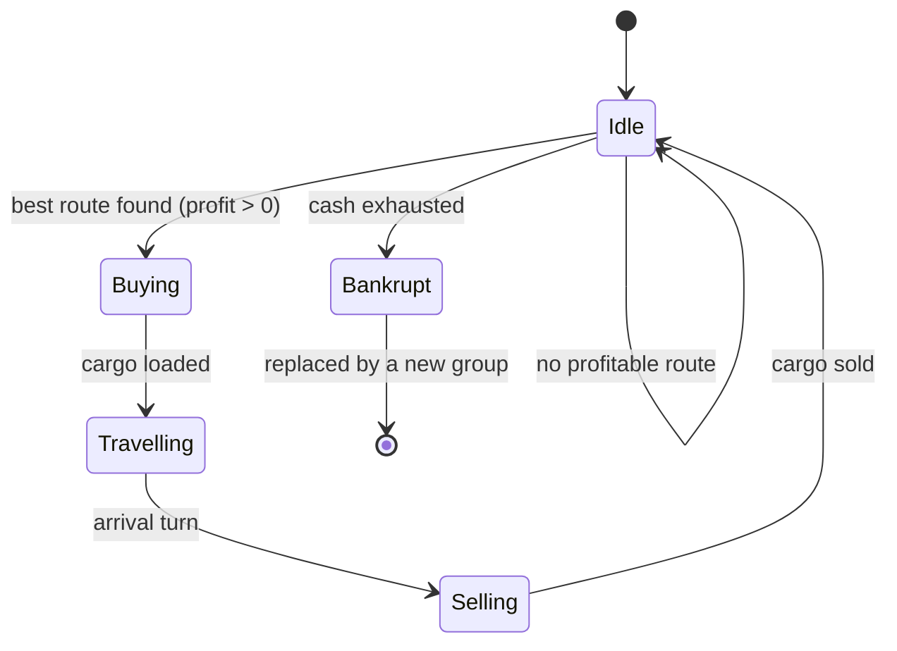

# NPC merchants

## Purpose
Merchant groups move goods between markets, so regional price gaps close over time and trade routes emerge
without scripting. Their counts per node are already in config (`merchants.<level>`).

## Rules
- [Confirmed] Merchants choose trades by arbitrage: buy where a good is cheap, sell where it is dear, when the
  price gap exceeds the transport cost (DEC-003).
- [Confirmed] Merchants carry real cargo, limited by size and weight capacity (DEC-003, DEC-009).
- [Confirmed] Merchant travel takes the route's travel turns; goods are in transit meanwhile (DEC-003).
- [Confirmed] Merchants of aggregate (far) nodes are not stepped one by one: trade between nodes is
  approximated as flows proportional to price gaps (DEC-003).
- [Confirmed] Merchants trade at the current price, their volumes feed supply and demand, and orders beyond
  stock fill partially, like the player (DEC-006, DEC-020).
- [Confirmed] Merchants pay the same base fees, per-unit charges and tolls as the player (DEC-015).
- [Confirmed] A merchant group whose cash runs out goes bankrupt and is replaced by a new group (DEC-011).
- [Draft] Merchant capacity per level starts as placeholder config values (DEC-013).
- [Confirmed] Only some merchant groups hold licenses; the others cannot sell licensed goods (DEC-024).
- [Confirmed] Merchants in detailed regions roll encounters; far regions apply the expected loss (DEC-026).
- [Confirmed] Merchants read only the yearly published statistics, like the player (DEC-043).
- [Confirmed] Merchants need no ship for sea and river routes (DEC-034).
- [Confirmed] Merchant groups can borrow from banks (DEC-037).
- [Confirmed] A merchant group pledges deposits, warehouse cargo and cart cargo as collateral (DEC-038).

## Arbitrage value
```
profit = sell_price(dest) * qty - buy_price(origin) * qty
       - base_fee - qty * cost_per_unit - sum(tolls on every node entered)
```
Trades across continents need the other continent's coins, exchanged at an international bank (DEC-031,
SYS-BANKING).

## Flow (detailed merchant)


## Edge cases
- Price gap closing while the merchant is still travelling: the sale happens at the arrival price.
- Partial fill at purchase: the merchant travels with what it got if the trip is still profitable.

## Unity implementation notes
- Replace `IdleMerchantBehavior` behind the existing `IMerchantBehavior` service; `MerchantSystem`
  already splits detailed merchants (`RunDetailed`) from aggregate nodes (`RunAggregate`).
- `AgentTable` gains trip state (destination, arrival turn) and a cargo reference; cargo storage is shared
  with SYS-INVENTORY. Replacement after bankruptcy reuses the row, so ids stay stable.
- Tolls on every entered node make multi-hop route search expensive: limit candidates to one or two hops
  and precompute per-route toll multipliers once per turn.
- The aggregate pass should be a Burst job from the start (9,250 groups at full scale).

