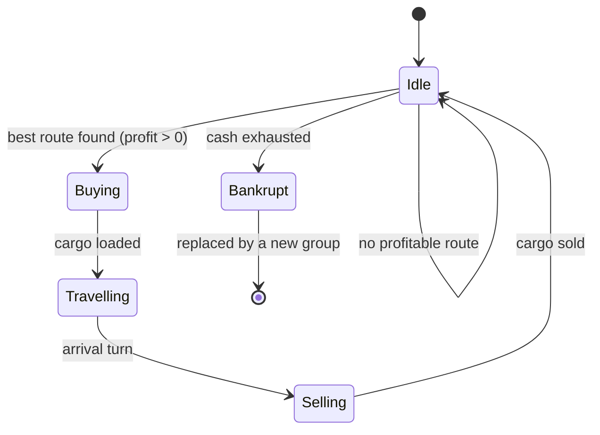

# NPC merchants

## Purpose
Merchant groups move goods between markets, so regional price gaps close over time and trade routes emerge
without scripting. Their counts per node are already in config (`merchants.<level>`).

## Rules
- [Confirmed] Merchants choose trades by arbitrage: buy where a good is cheap, sell where it is dear, when the
  price gap exceeds the transport cost (DEC-003).
- [Confirmed] Merchants carry real cargo, limited by size and weight capacity (DEC-003, DEC-009).
- [Confirmed] Merchant travel takes the route's travel turns; goods are in transit meanwhile (DEC-003).
- [Confirmed] Merchants of aggregate (far) nodes are not stepped one by one: trade between nodes is
  approximated as flows proportional to price gaps (DEC-003).
- [Confirmed] Merchants trade at the current price, their volumes feed supply and demand, and orders beyond
  stock fill partially, like the player (DEC-006, DEC-020).
- [Confirmed] Merchants pay the same base fees, per-unit charges and tolls as the player (DEC-015).
- [Confirmed] A merchant group whose cash runs out goes bankrupt and is replaced by a new group (DEC-011).
- [Draft] Merchant capacity per level starts as placeholder config values (DEC-013).
- [Confirmed] Only some merchant groups hold licenses; the others cannot sell licensed goods (DEC-024).
- [Confirmed] Merchants in detailed regions roll encounters; far regions apply the expected loss (DEC-026).
- [Confirmed] Merchants read only the yearly published statistics, like the player (DEC-043).
- [Confirmed] Merchants need no ship for sea and river routes (DEC-034).
- [Confirmed] Merchant groups can borrow from banks (DEC-037).
- [Confirmed] A merchant group pledges deposits, warehouse cargo and cart cargo as collateral (DEC-038).
- [Confirmed] Large merchant groups trade between continents, changing coins at international banks;
  flows on routes between continents run at 65% of the normal flow share (DEC-066).
- [Draft] (Claude's reading of DEC-066) "Large" means groups based at nation or continent level; aggregate
  flows also cross continents at 65%, the margin taken after the exchange rate and fee. Until built (P17)
  groups stay on their home continent.
- [Confirmed] The player can hire merchant groups (DEC-064, SYS-AUTOMATION).
- [Draft] Claude's proposals, built in P5:
  - A detailed group carries one good per trip along one route out of its node, choosing the most
    profitable load after the base fee, per-unit charge and toll; it sells the whole load on arrival.
  - Groups stay on their home continent: their cash is one continent's coin and they do not exchange yet.
  - Like facilities (DEC-051), a detailed group pays a weekly upkeep (50 / 40 / 30 / 20 / 10 per level of
    its home) and goes bankrupt after 5 weeks below zero (`merchants.<level>.upkeep`,
    `merchants.bankrupt_weeks`); aggregate groups pay none.
  - Aggregate flows move a share of the origin's stock (50%, `merchants.flow_permille`) times the margin
    over the destination price, within the node's pooled capacity, and arrive the same week, with no base
    fee; they lose the route's expected encounter share (P8). Between nations the destination's traders
    pay the origin's for the goods at the origin price, within their float (P13b, DEC-061).
  - A group arriving sells only as many units as the traders there can pay for; the rest stays on board
    (P13b).
  - Capacity per group: weight 4,000 / 4,000 / 2,000 / 1,000 / 400 and size 3,200 / 3,200 / 1,600 /
    800 / 300 per level (`merchants.<level>.max_weight`, `max_size`).
  - Since P9b, an NPC group whose cash ended a week below zero borrows against the cargo it carries
    (SYS-BANKING); a group going bankrupt leaves its loan unpaid.

## Arbitrage value
```
profit = sell_price(dest) * qty - buy_price(origin) * qty
       - base_fee - qty * cost_per_unit - sum(tolls on every node entered)
```
Trades across continents need the other continent's coins, exchanged at an international bank (DEC-031,
SYS-BANKING).

## Flow (detailed merchant)


## Edge cases
- Price gap closing while the merchant is still travelling: the sale happens at the arrival price.
- Partial fill at purchase: the merchant travels with what it got if the trip is still profitable.

## Unity implementation notes
Implemented in P5.
- `ArbitrageMerchantBehavior` is the default `IMerchantBehavior`. `MerchantSystem` calls `RunDetailed` for
  every group of a detailed node and every group on a trip, then `RunAggregate` once.
- `AgentTable` (section version 2, `AgentTableV1Migration`) has `Home`, `Destination`, `ArrivalTurn` and
  `NegativeCashWeeks`; loads are `CargoHolders.Merchant(agent)` rows in `CargoTable`. Replacement after
  bankruptcy reuses the row (`MerchantBankrupt` event), so ids stay stable.
- Trip costs come from `TravelCosts.Quote`, the player's function (DEC-015); licensed goods follow
  `LicenseRules.MerchantHoldsLicenses`.
- Both passes scan only the stocked cells of the origin market and binary-search the destination's cell:
  most cells hold no stock. `MerchantFlowJob` (Burst, single-threaded, nodes in order) is the aggregate
  pass; at full scale merchants take about 7.6 ms of a 14.7 ms turn (aggregate 4.2 ms, 155 detailed
  groups 2.6 ms).

