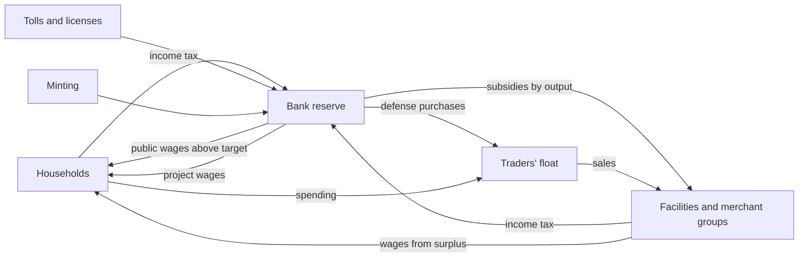

# The state's economy

How money reaches the state and returns to the market. Every number here is a `config.csv` key (02_Data_Formats).
The decisions hold the reasons; this page holds the rules as they stand.

## Money flow

## Labor market
- [Confirmed] Merchant groups pay wages from surplus cash into the labor market, reaching the nation's households. The
  employment rate rises and falls with an economic indicator (DEC-070).
- [Draft] One rate per float, starting at 90%, within 50 to 100%. The indicator is real household spending per head
  against its own long-run level, read each quarter. Wages are 10% a week of cash above starting cash, times the rate,
  split by population. Facility upkeep is not scaled by the rate.

## Income tax
- [Confirmed] Every node's households and every facility and merchant group pay 10% of the year's income, once a year, to
  the bank reserve of their nation (DEC-071). Outside a nation it goes to the international bank.
- [Draft] Households' income is the measured income the income-per-head rule uses, so that rule sees income after tax. A
  company's profit is its change in cash plus dividends paid. Losses carry no relief, nobody pays beyond the cash held, and
  a new operator starts new books. Bank-held facilities, interest groups and the player's own purse pay nothing.

## Defense
- [Confirmed] A nation spends a fixed 5% of its budget on a standing army and mercenaries, with maintenance on top,
  directly in its own markets (DEC-072). Safety grows in proportion to the spending; a war system comes later (DEC-074, P19).
- [Draft] The budget is the reserve at the year's start less the player's deposits; maintenance is 20% on top. Purchases
  run every 4 weeks across all stock by value. Safety is yearly defense per route over 15,000, cutting at most 60% of danger.

## Land development
- [Confirmed] Nations build ports, coast-to-inland highways, paved roads between towns, mines and farmland, choosing from
  what holds production back and what they spend on imports. Projects give a bonus to land outside the nodes, and state
  facilities pay the state part of their profit (DEC-072). Each year's plan is reserved and built in order (DEC-074).
- [Draft] Half the reserve above target funds up to 3 projects a year, one of each kind, 16 weeks each; those not started
  by the next plan are dropped. Scores: necessity shortfall for farmland, dear mined goods for mines, import bill for
  harbors and highways, a flat score for paving.
- [Draft] The map has no tiles, so the land around a node stands in for them (moves to tiles in P18, DEC-075): +10% primary
  output per level, at most 5; harbors -10% per level on water routes from there; highways -20% on the route's charge.
  Farmland and mines also open a facility of the state enterprise; the state collects 50% of its dividends.

## Subsidies
- [Confirmed] A nation can enact a subsidy on a good, paid in proportion to output, so existing producers take it up and
  new companies and guilds appear (DEC-074).
- [Draft] With money above target a nation enacts on its dearest good, at most 2 at a time for 3 years, paying 20% of the
  output's value out of 30% of the excess a year. Each year of a policy one producer opens at the node shortest of
  necessities, under a group already making the good or a newly founded company; a guild is founded where the site's city
  has none of that trade. Player facilities get no subsidy (open, see 04_Roadmap).

## Nobles and royal houses
- [Confirmed] Noble and royal houses manage villages and cities; the royal blood collects tax first; lord and vassal owe each
  other under a two-way contract (DEC-076).
- [Draft] Shares, aid, protection, the domain and spending are in DEC-076; protection has no effect on route danger yet.

## Free people and migration
- [Confirmed] Town jobs pay better, free people may move, and villagers leave for towns over about fifteen years (DEC-079).
- [Draft] Rules and real cases are in DEC-079. `MigrationState` and `MigrationSystem` hold them; off unless `migration.max_share_permille` is set.

## Implementation
`NobleState`, `NobleSystem` and `Nobles.CollectTax` hold the houses; `MoneyLedger.PayNationWages` applies the wage weights.
`LaborMarketSystem`, `IncomeTaxSystem`, `DefenseSystem` (with `DefensePurchaseJob`), `StateProjectSystem`, `SubsidySystem`,
all in the Finance phase; state in `LaborState`, `IncomeTaxState`, `DevelopmentState`. Tests: `StateProjectTests`, `MoneyTests`.
